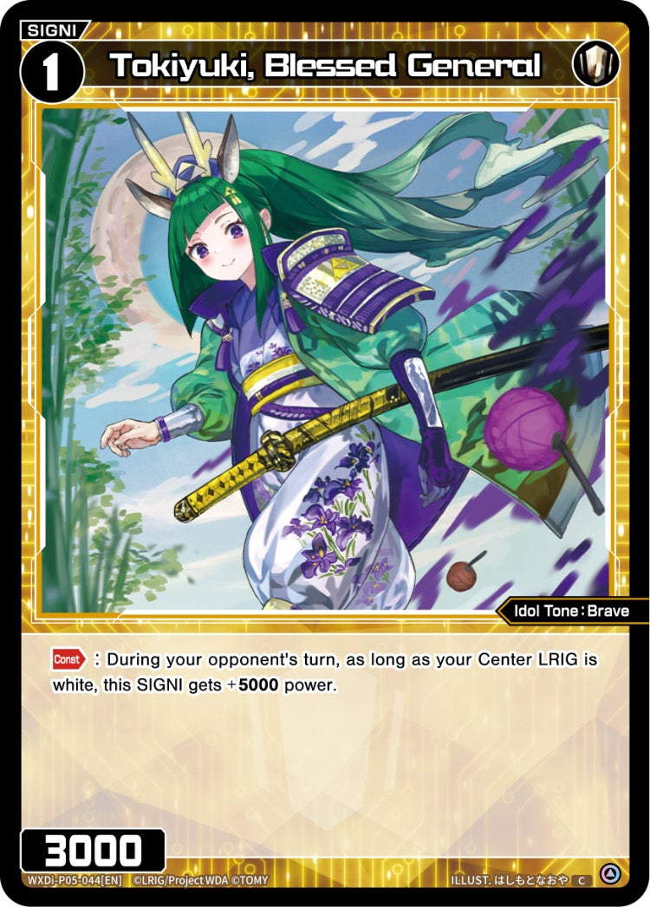

# Tokiyuki, Blessed General

## Thông tin lá

| Trường | Giá trị |
| --- | --- |
| Mã in | WXDi-P05-044[EN] |
| Set | WXDi-P05[EN] |
| Số thứ tự | 044 |
| Loại thẻ | SIGNI |
| Vị trí | Main Deck |
| Số bản | — (set booster, không áp dụng) |
| Màu | Trắng |
| Độ hiếm | C,C(P) |
| Minh họa | はしもとなおや |
| Level | 1 |
| Limit | — |
| Power | 3000 |
| LRIG type / Class | Idol Tone：Brave |
| Team / Master | — |
| Cost | — |
| Grow cost | — |
| Use timing | — |
| Life Burst | Không |

## Card text chính thức

[Constant]: During your opponent's turn, as long as your Center LRIG is white, this SIGNI gets +5000 power.

## Power text / Life Burst

—

## Ghi chú minh họa
Artist: はしもとなおや. Ảnh C được tải từ Card List tiếng Anh.

## FAQ chính thức

— (không có FAQ riêng cho mã này trên trang FAQ tiếng Anh.)

## Ảnh biến thể

- [C(P)](../images/WXDi-P05-044P-EN.jpg)

## Nguồn
[Card List/FAQ chính thức](https://www.takaratomy.co.jp/products/en.wixoss/card/card.html?card_no=WXDi-P05-044%5BEN%5D ) · [Ảnh thẻ](https://www.takaratomy.co.jp/products/en.wixoss/card/thumb/WXDi-P05-044%5BEN%5D.jpg)
