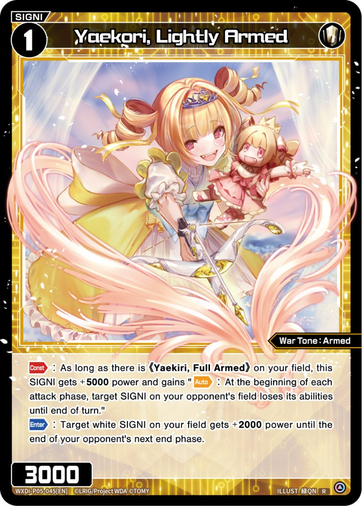

# Yaekori, Lightly Armed

## Thông tin lá

| Trường | Giá trị |
| --- | --- |
| Mã in | WXDi-P05-045[EN] |
| Set | WXDi-P05[EN] |
| Số thứ tự | 045 |
| Loại thẻ | SIGNI |
| Vị trí | Main Deck |
| Số bản | — (set booster, không áp dụng) |
| Màu | Trắng |
| Độ hiếm | R,R(P) |
| Minh họa | 緑QN |
| Level | 1 |
| Limit | — |
| Power | 3000 |
| LRIG type / Class | War Tone：Armed |
| Team / Master | — |
| Cost | — |
| Grow cost | — |
| Use timing | — |
| Life Burst | Không |

## Card text chính thức

[Constant]: As long as there is 《Yaekiri, Full Armed》 on your field, this SIGNI gets +5000 power and gains "[Auto]: At the beginning of each attack phase, target SIGNI on your opponent's field loses its abilities until end of turn."
[Enter]: Target white SIGNI on your field gets +2000 power until the end of your opponent's next end phase.

## Power text / Life Burst

—

## Ghi chú minh họa
Artist: 緑QN. Ảnh R được tải từ Card List tiếng Anh.

## FAQ chính thức

**Q. Both players have 《Yaekiri, Full Armed》 and 《Yaekori, Lightly Armed》 on their owners' fields. What happens to the [Constant] ability at the beginning of the aAttack phase?**
A. At the beginning of the aAttack phase, the [Constant] ability of each player's 《Yaekori, Lightly Armed》 is triggered, and the turn player resolves first. Even if the another player's 《Yaekori, Lightly Armed》 loses its abilities, the already triggered ability is still activated, and the non-turn player may also make the target SIGNI lose its abilities.

## Ảnh biến thể

- [R(P)](../images/WXDi-P05-045P-EN.jpg)

## Nguồn
[Card List/FAQ chính thức](https://www.takaratomy.co.jp/products/en.wixoss/card/card.html?card_no=WXDi-P05-045%5BEN%5D ) · [Ảnh thẻ](https://www.takaratomy.co.jp/products/en.wixoss/card/thumb/WXDi-P05-045%5BEN%5D.jpg)
