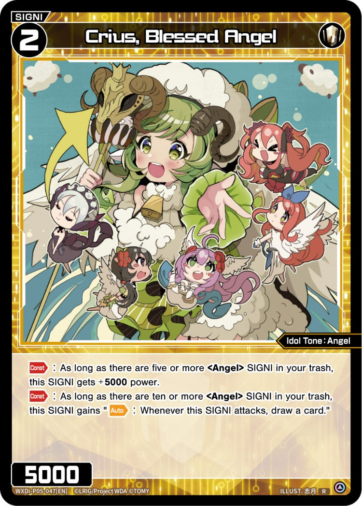

# Crius, Blessed Angel

## Thông tin lá

| Trường | Giá trị |
| --- | --- |
| Mã in | WXDi-P05-047[EN] |
| Set | WXDi-P05[EN] |
| Số thứ tự | 047 |
| Loại thẻ | SIGNI |
| Vị trí | Main Deck |
| Số bản | — (set booster, không áp dụng) |
| Màu | Trắng |
| Độ hiếm | R,R(P) |
| Minh họa | 志月 |
| Level | 2 |
| Limit | — |
| Power | 5000 |
| LRIG type / Class | Idol Tone：Angel |
| Team / Master | — |
| Cost | — |
| Grow cost | — |
| Use timing | — |
| Life Burst | Không |

## Card text chính thức

[Constant]: As long as there are five or more <Angel> SIGNI in your trash, this SIGNI gets +5000 power.
[Constant]: As long as there are ten or more <Angel> SIGNI in your trash, this SIGNI gains "[Auto]: Whenever this SIGNI attacks, draw a card."

## Power text / Life Burst

—

## Ghi chú minh họa
Artist: 志月. Ảnh R được tải từ Card List tiếng Anh.

## FAQ chính thức

**Q. If there are ten or more <Angel> SIGNIs in my trash, do I get the effect of both [Constant] abilities?**
A. Yes, the conditions for both [Constant] abilities are met.

## Ảnh biến thể

- [R(P)](../images/WXDi-P05-047P-EN.jpg)

## Nguồn
[Card List/FAQ chính thức](https://www.takaratomy.co.jp/products/en.wixoss/card/card.html?card_no=WXDi-P05-047%5BEN%5D ) · [Ảnh thẻ](https://www.takaratomy.co.jp/products/en.wixoss/card/thumb/WXDi-P05-047%5BEN%5D.jpg)
