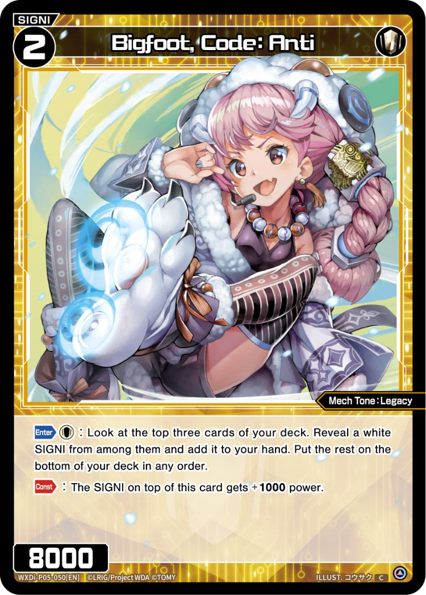

# Bigfoot, Code: Anti

## Thông tin lá

| Trường | Giá trị |
| --- | --- |
| Mã in | WXDi-P05-050[EN] |
| Set | WXDi-P05[EN] |
| Số thứ tự | 050 |
| Loại thẻ | SIGNI |
| Vị trí | Main Deck |
| Số bản | — (set booster, không áp dụng) |
| Màu | Trắng |
| Độ hiếm | C,C(P) |
| Minh họa | コウサク |
| Level | 2 |
| Limit | — |
| Power | 8000 |
| LRIG type / Class | Mech Tone：Legacy |
| Team / Master | — |
| Cost | — |
| Grow cost | — |
| Use timing | — |
| Life Burst | Không |

## Card text chính thức

[Enter] {White}: Look at the top three cards of your deck. Reveal a white SIGNI from among them and add it to your hand. Put the rest on the bottom of your deck in any order.

[Constant]: The SIGNI on top of this card gets +1000 power.

## Power text / Life Burst

—

## Ghi chú minh họa
Artist: コウサク. Ảnh C được tải từ Card List tiếng Anh.

## FAQ chính thức

**Q. What happens there are three or less cards in my deck when this card triggered the [Enter] ability?**
A. In that case, the effect is processed by looking at those three or less cards. If there are more than one card in your deck after the effect is processed, refresh is not done.

## Ảnh biến thể

- [C(P)](../images/WXDi-P05-050P-EN.jpg)

## Nguồn
[Card List/FAQ chính thức](https://www.takaratomy.co.jp/products/en.wixoss/card/card.html?card_no=WXDi-P05-050%5BEN%5D ) · [Ảnh thẻ](https://www.takaratomy.co.jp/products/en.wixoss/card/thumb/WXDi-P05-050%5BEN%5D.jpg)
