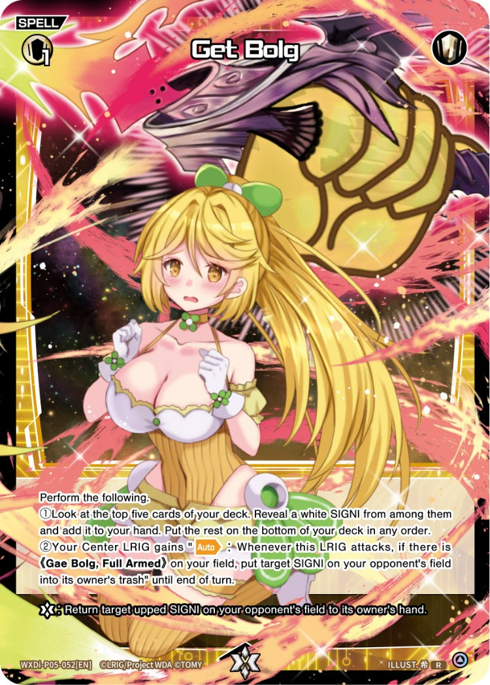

# Get Bolg

## Thông tin lá

| Trường | Giá trị |
| --- | --- |
| Mã in | WXDi-P05-052[EN] |
| Set | WXDi-P05[EN] |
| Số thứ tự | 052 |
| Loại thẻ | SPELL |
| Vị trí | Main Deck |
| Số bản | — (set booster, không áp dụng) |
| Màu | Trắng |
| Độ hiếm | R,R(P) |
| Minh họa | 希 |
| Level | — |
| Limit | — |
| Power | 0 |
| LRIG type / Class | — |
| Team / Master | — |
| Cost | 《W》×１ |
| Grow cost | — |
| Use timing | — |
| Life Burst | Có |

## Card text chính thức

Perform the following.
①Look at the top five cards of your deck. Reveal a white SIGNI from among them and add it to your hand. Put the rest on the bottom of your deck in any order.
②Your Center LRIG gains "[Auto]: Whenever this LRIG attacks, if there is 《Gae Bolg, Full Armed》 on your field, put target SIGNI on your opponent's field into its owner's trash" until end of turn.

## Power text / Life Burst

Return target upped SIGNI on your opponent's field to its owner's hand.

## Ghi chú minh họa
Artist: 希. Ảnh R được tải từ Card List tiếng Anh.

## FAQ chính thức

**Q. What happens if there are five or less cards in my deck when the effect of ① is processed?**
A. In that case, the effect is processed by looking at those five or less cards. If there are more than one card in your deck after the effect is processed, refresh is not done.

## Ảnh biến thể

- [R(P)](../images/WXDi-P05-052P-EN.jpg)

## Nguồn
[Card List/FAQ chính thức](https://www.takaratomy.co.jp/products/en.wixoss/card/card.html?card_no=WXDi-P05-052%5BEN%5D ) · [Ảnh thẻ](https://www.takaratomy.co.jp/products/en.wixoss/card/thumb/WXDi-P05-052%5BEN%5D.jpg)
