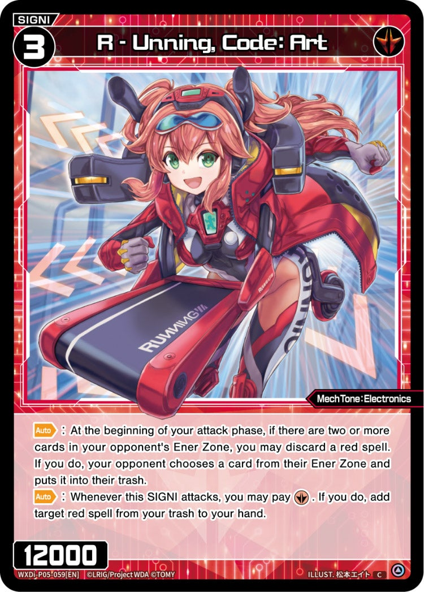

# R - Unning, Code: Art

## Thông tin lá

| Trường | Giá trị |
| --- | --- |
| Mã in | WXDi-P05-059[EN] |
| Set | WXDi-P05[EN] |
| Số thứ tự | 059 |
| Loại thẻ | SIGNI |
| Vị trí | Main Deck |
| Số bản | — (set booster, không áp dụng) |
| Màu | Đỏ |
| Độ hiếm | C,C(P) |
| Minh họa | 松本エイト |
| Level | 3 |
| Limit | — |
| Power | 12000 |
| LRIG type / Class | Mech Tone：Electronics |
| Team / Master | — |
| Cost | — |
| Grow cost | — |
| Use timing | — |
| Life Burst | Không |

## Card text chính thức

[Auto]: At the beginning of your attack phase, if there are two or more cards in your opponent's Ener Zone, you may discard a red spell. If you do, your opponent chooses a card from their Ener Zone and puts it into their trash.
[Auto]: Whenever this SIGNI attacks, you may pay {Red}. If you do, add target red spell from your trash to your hand.

## Power text / Life Burst

—

## Ghi chú minh họa
Artist: 松本エイト. Ảnh C được tải từ Card List tiếng Anh.

## FAQ chính thức

**Q. What happens if there are two 《R - Unning, Code: Art》 on my field and two cards on my opponent's Ener Zone at the beginning of my aAttack phase.**
A. At the beginning of your aAttack phase, the first [Auto] abilities of both 《R - Unning, Code: Art》 are triggered and resolved in turn. If the first 《R - Unning, Code: Art》 triggers its ability and your opponent put a card into their trash from their Ener Zone, the second 《R - Unning, Code: Art》 triggers its ability, but there is only one card in their Ener Zone. Since there is only one card, nothing happens with the effect of the second ability.

**Q. If I paid for a {Red} Ener Cost of the second [Auto] ability is a red spell, may I target it and put it into my hand?**
A. No, you cannot. This ability pays Ener Cost after target a red spell first.

## Ảnh biến thể

- [C(P)](../images/WXDi-P05-059P-EN.jpg)

## Nguồn
[Card List/FAQ chính thức](https://www.takaratomy.co.jp/products/en.wixoss/card/card.html?card_no=WXDi-P05-059%5BEN%5D ) · [Ảnh thẻ](https://www.takaratomy.co.jp/products/en.wixoss/card/thumb/WXDi-P05-059%5BEN%5D.jpg)
