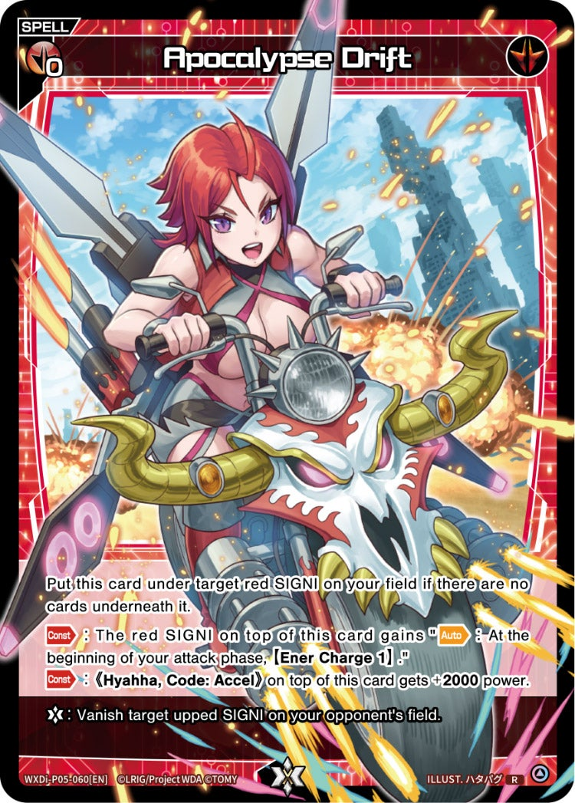

# Apocalypse Drift

## Thông tin lá

| Trường | Giá trị |
| --- | --- |
| Mã in | WXDi-P05-060[EN] |
| Set | WXDi-P05[EN] |
| Số thứ tự | 060 |
| Loại thẻ | SPELL |
| Vị trí | Main Deck |
| Số bản | — (set booster, không áp dụng) |
| Màu | Đỏ |
| Độ hiếm | R,R(P) |
| Minh họa | ハタパグ |
| Level | — |
| Limit | — |
| Power | 0 |
| LRIG type / Class | — |
| Team / Master | — |
| Cost | 《R》×０ |
| Grow cost | — |
| Use timing | — |
| Life Burst | Có |

## Card text chính thức

Put this card under target red SIGNI on your field if there are no cards underneath it.

[Constant]: The red SIGNI on top of this card gains "[Auto]: At the beginning of your attack phase, 【Ener Charge 1】."
[Constant]: 《Hyahha, Code: Accel》 on top of this card gets +2000 power.

## Power text / Life Burst

Vanish target upped SIGNI on your opponent's field.

## Ghi chú minh họa
Artist: ハタパグ. Ảnh R được tải từ Card List tiếng Anh.

## FAQ chính thức

**Q. I played this spell and put this spell under a red SIGNI. If the red SIGNI leaves my field, what happens to the spell underneath it?**
A. Like cards placed underneath in [Rise], etc., if the top SIGNI leaves the field, all cards that were underneath it are put into their owner's trash as a rule-based action.

**Q. What happens to the [Constant] abilities if this spell in my trash and a red SIGNI on top of it?**
A. A SIGNI only gains the [Constant] abilities when there is a 《Apocalypse Drift》 under a SIGNI on the field. Even if they physically overlap, such as in a trash, this card does not give the [Constant] abilities.

## Ảnh biến thể

- [R(P)](../images/WXDi-P05-060P-EN.jpg)

## Nguồn
[Card List/FAQ chính thức](https://www.takaratomy.co.jp/products/en.wixoss/card/card.html?card_no=WXDi-P05-060%5BEN%5D ) · [Ảnh thẻ](https://www.takaratomy.co.jp/products/en.wixoss/card/thumb/WXDi-P05-060%5BEN%5D.jpg)
