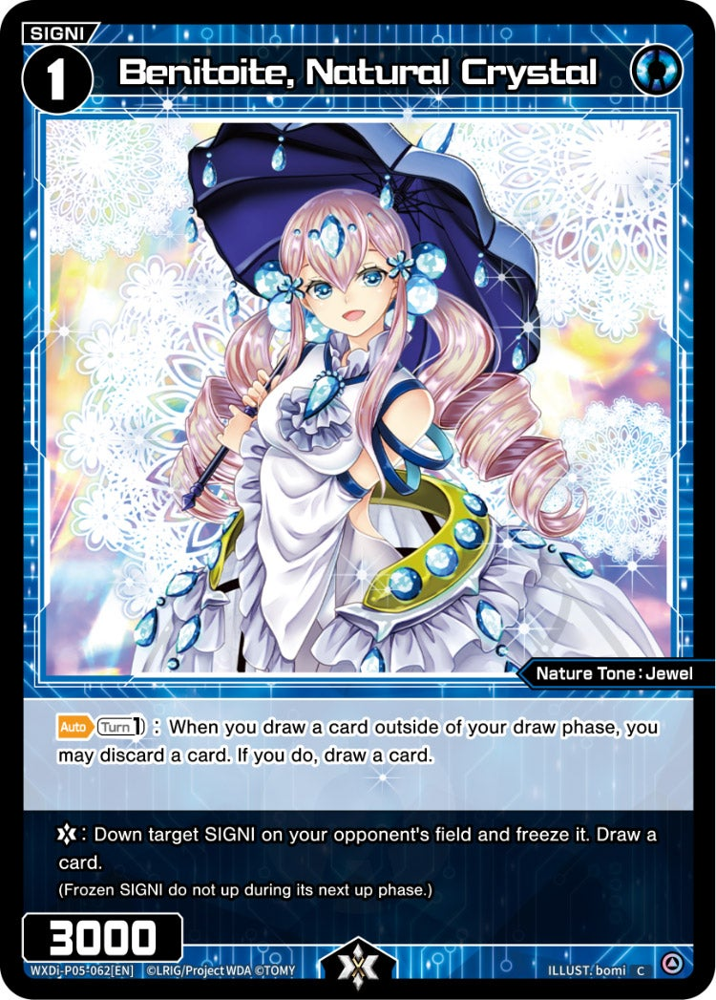

# Benitoite, Natural Crystal

## Thông tin lá

| Trường | Giá trị |
| --- | --- |
| Mã in | WXDi-P05-062[EN] |
| Set | WXDi-P05[EN] |
| Số thứ tự | 062 |
| Loại thẻ | SIGNI |
| Vị trí | Main Deck |
| Số bản | — (set booster, không áp dụng) |
| Màu | Xanh dương |
| Độ hiếm | C,C(P) |
| Minh họa | bomi |
| Level | 1 |
| Limit | — |
| Power | 3000 |
| LRIG type / Class | Nature Tone：Jewel |
| Team / Master | — |
| Cost | — |
| Grow cost | — |
| Use timing | — |
| Life Burst | Có |

## Card text chính thức

[Auto] {1/Turn}: When you draw a card outside of your draw phase, you may discard a card. If you do, draw a card.

## Power text / Life Burst

Down target SIGNI on your opponent's field and freeze it. Draw a card.
(Frozen SIGNI do not up during its next up phase.)

## Ghi chú minh họa
Artist: bomi. Ảnh C được tải từ Card List tiếng Anh.

## FAQ chính thức

**Q. Does this ability trigger if the effect "draw two cards" is triggered and draw two cards?**
A. Yes, it triggers. It triggers twice because two cards were drawn, but it is the ability that is limited to once per turn, so even then it only triggers once.

## Ảnh biến thể

- [C(P)](../images/WXDi-P05-062P-EN.jpg)

## Nguồn
[Card List/FAQ chính thức](https://www.takaratomy.co.jp/products/en.wixoss/card/card.html?card_no=WXDi-P05-062%5BEN%5D ) · [Ảnh thẻ](https://www.takaratomy.co.jp/products/en.wixoss/card/thumb/WXDi-P05-062%5BEN%5D.jpg)
