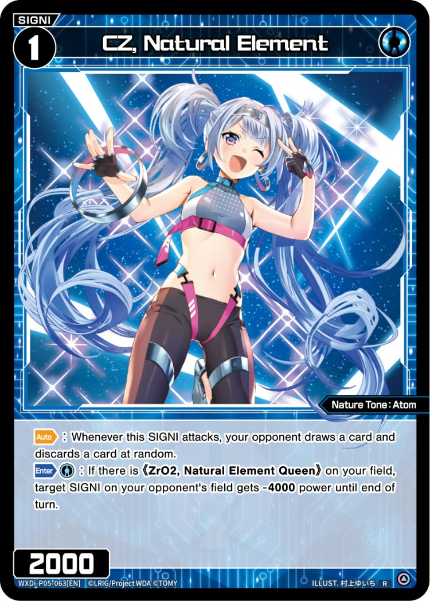

# CZ, Natural Element

## Thông tin lá

| Trường | Giá trị |
| --- | --- |
| Mã in | WXDi-P05-063[EN] |
| Set | WXDi-P05[EN] |
| Số thứ tự | 063 |
| Loại thẻ | SIGNI |
| Vị trí | Main Deck |
| Số bản | — (set booster, không áp dụng) |
| Màu | Xanh dương |
| Độ hiếm | R,R(P) |
| Minh họa | 村上ゆいち |
| Level | 1 |
| Limit | — |
| Power | 2000 |
| LRIG type / Class | Nature Tone：Atom |
| Team / Master | — |
| Cost | — |
| Grow cost | — |
| Use timing | — |
| Life Burst | Không |

## Card text chính thức

[Auto]: Whenever this SIGNI attacks, your opponent draws a card and discards a card at random.
[Enter] {Blue}: If there is 《ZrO2, Natural Element Queen》 on your field, target SIGNI on your opponent's field gets -4000 power until end of turn.

## Power text / Life Burst

—

## Ghi chú minh họa
Artist: 村上ゆいち. Ảnh R được tải từ Card List tiếng Anh.

## FAQ chính thức

**Q. Does the [Auto] ability must be triggered?**
A. Yes, the [Auto] ability that meets the condition must trigger.

## Ảnh biến thể

- [R(P)](../images/WXDi-P05-063P-EN.jpg)

## Nguồn
[Card List/FAQ chính thức](https://www.takaratomy.co.jp/products/en.wixoss/card/card.html?card_no=WXDi-P05-063%5BEN%5D ) · [Ảnh thẻ](https://www.takaratomy.co.jp/products/en.wixoss/card/thumb/WXDi-P05-063%5BEN%5D.jpg)
