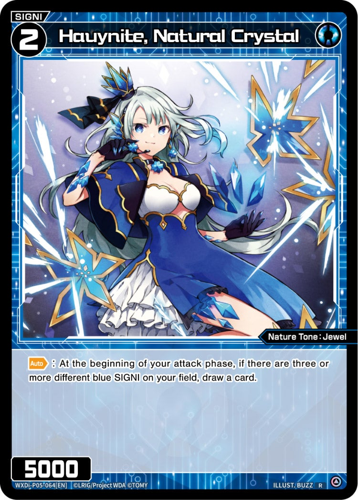

# Hauynite, Natural Crystal

## Thông tin lá

| Trường | Giá trị |
| --- | --- |
| Mã in | WXDi-P05-064[EN] |
| Set | WXDi-P05[EN] |
| Số thứ tự | 064 |
| Loại thẻ | SIGNI |
| Vị trí | Main Deck |
| Số bản | — (set booster, không áp dụng) |
| Màu | Xanh dương |
| Độ hiếm | R,R(P) |
| Minh họa | BUZZ |
| Level | 2 |
| Limit | — |
| Power | 5000 |
| LRIG type / Class | Nature Tone：Jewel |
| Team / Master | — |
| Cost | — |
| Grow cost | — |
| Use timing | — |
| Life Burst | Không |

## Card text chính thức

[Auto]: At the beginning of your attack phase, if there are three or more different blue SIGNI on your field, draw a card.

## Power text / Life Burst

—

## Ghi chú minh họa
Artist: BUZZ. Ảnh R được tải từ Card List tiếng Anh.

## FAQ chính thức

**Q. What exactly do I need to check for the condition of three different blue SIGNIs?**
A. If there are three or more blue SIGNIs with different card names, you may draw a card by the [Auto] ability of 《Hauynite, Natural Crystal》.

## Ảnh biến thể

- [R(P)](../images/WXDi-P05-064P-EN.jpg)

## Nguồn
[Card List/FAQ chính thức](https://www.takaratomy.co.jp/products/en.wixoss/card/card.html?card_no=WXDi-P05-064%5BEN%5D ) · [Ảnh thẻ](https://www.takaratomy.co.jp/products/en.wixoss/card/thumb/WXDi-P05-064%5BEN%5D.jpg)
