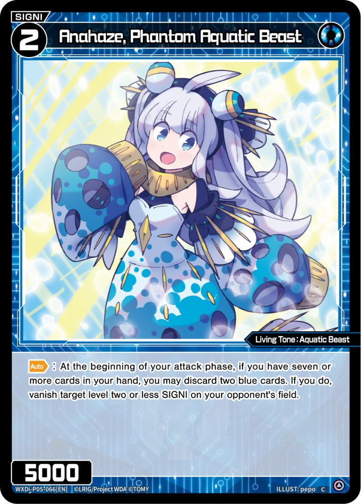

# Anahaze, Phantom Aquatic Beast

## Thông tin lá

| Trường | Giá trị |
| --- | --- |
| Mã in | WXDi-P05-066[EN] |
| Set | WXDi-P05[EN] |
| Số thứ tự | 066 |
| Loại thẻ | SIGNI |
| Vị trí | Main Deck |
| Số bản | — (set booster, không áp dụng) |
| Màu | Xanh dương |
| Độ hiếm | C,C(P) |
| Minh họa | pepo |
| Level | 2 |
| Limit | — |
| Power | 5000 |
| LRIG type / Class | Living Tone：Aquatic Beast |
| Team / Master | — |
| Cost | — |
| Grow cost | — |
| Use timing | — |
| Life Burst | Không |

## Card text chính thức

[Auto]: At the beginning of your attack phase, if you have seven or more cards in your hand, you may discard two blue cards. If you do, vanish target level two or less SIGNI on your opponent's field.

## Power text / Life Burst

—

## Ghi chú minh họa
Artist: pepo. Ảnh C được tải từ Card List tiếng Anh.

## FAQ chính thức

**Q. What happens if there are two 《Anahaze, Phantom Aquatic Beast》 on my field and I have seven cards in my hand at the beginning of my aAttack phase?**
A. At the beginning of your aAttack phase, the [Auto] abilities of both 《Anahaze, Phantom Aquatic Beast》 are triggered and resolved in turn. Also, whether you have seven or more cards in your hand is checked when resolving the effect; If the first 《nahaze, Phantom Aquatic Beast》 triggers its ability and discard two blue cards from your hand, the second 《nahaze, Phantom Aquatic Beast》 triggers its ability, but you have five cards in your hand, so nothing happens with the effect of the seconde ability.

## Ảnh biến thể

- [C(P)](../images/WXDi-P05-066P-EN.jpg)

## Nguồn
[Card List/FAQ chính thức](https://www.takaratomy.co.jp/products/en.wixoss/card/card.html?card_no=WXDi-P05-066%5BEN%5D ) · [Ảnh thẻ](https://www.takaratomy.co.jp/products/en.wixoss/card/thumb/WXDi-P05-066%5BEN%5D.jpg)
