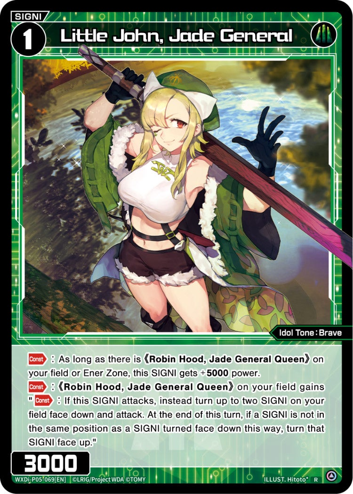

# Little John, Jade General

## Thông tin lá

| Trường | Giá trị |
| --- | --- |
| Mã in | WXDi-P05-069[EN] |
| Set | WXDi-P05[EN] |
| Số thứ tự | 069 |
| Loại thẻ | SIGNI |
| Vị trí | Main Deck |
| Số bản | — (set booster, không áp dụng) |
| Màu | Xanh lá |
| Độ hiếm | R,R(P) |
| Minh họa | Hitoto* |
| Level | 1 |
| Limit | — |
| Power | 3000 |
| LRIG type / Class | Idol Tone：Brave |
| Team / Master | — |
| Cost | — |
| Grow cost | — |
| Use timing | — |
| Life Burst | Không |

## Card text chính thức

[Constant]: As long as there is 《Robin Hood, Jade General Queen》 on your field or Ener Zone, this SIGNI gets +5000 power.
[Constant]: 《Robin Hood, Jade General Queen》 on your field gains "[Constant]: If this SIGNI attacks, instead turn up to two SIGNI on your field face down and attack. At the end of this turn, if a SIGNI is not in the same position as a SIGNI turned face down this way, turn that SIGNI face up."

## Power text / Life Burst

—

## Ghi chú minh họa
Artist: Hitoto*. Ảnh R được tải từ Card List tiếng Anh.

## FAQ chính thức

**Q. 《Robin Hood, Jade General Queen》 gains the [Constant] ability from the second ability of 《Little John, Jade General》, and 《Robin Hood, Jade General Queen》 turned 《Little John, Jade General》 face down with that ability. What happens to the effect at the end of the turn?**
A. When 《Little John, Jade General》 is turned face down, the [Constant] ability given to 《Robin Hood, Jade General Queen》 by this card's [Constant] ability is lost, but since the ability when 《Robin Hood, Jade General Queen》 attacks has already been triggered, the [Constant] ability at end of turn is also activated and can be turned face up. Also, even if 《Robin Hood, Jade General Queen》 leaves the field after attacking and is not already on the field at the end of the turn, it can be turned face up at the end of the turn in the same way.

**Q. What exactly does the second [Constant] ability of 《Little John, Jade General》 allow you to do when 《Little John, Jade General》 and 《Robin Hood, Jade General Queen》 are on the field?**
A. If there are 《Robin Hood, Jade General Queen》 and two other SIGNI on your field, you need to turn two of your other SIGNI face down at the beginning of your aAttack phase with the [Auto] ability of 《Robin Hood, Jade General Queen》 in order to put all SIGNI on your opponent's field into their Ener Zone with the [Constant] ability of 《Robin Hood, Jade General Queen》 when it attacks. So you cannot attack with the SIGNI with turned face down.

However, if there is 《Little John, Jade General》 on your field, the [Auto] ability of 《Robin Hood, Jade General Queen》 is replaced by ""if this SIGNI attacks"" instead of ""at the beginning of your Attak Phase"", so that after two other SIGNI attack, 《Robin Hood, Jade General Queen》 can attack and turn two other SIGNI face down. It can also activate the [Constant] ability of 《Robin Hood, Jade General Queen》 after it attacks.

A detailed explanation of these can also be found at URL~.

## Ảnh biến thể

- [R(P)](../images/WXDi-P05-069P-EN.jpg)

## Nguồn
[Card List/FAQ chính thức](https://www.takaratomy.co.jp/products/en.wixoss/card/card.html?card_no=WXDi-P05-069%5BEN%5D ) · [Ảnh thẻ](https://www.takaratomy.co.jp/products/en.wixoss/card/thumb/WXDi-P05-069%5BEN%5D.jpg)
