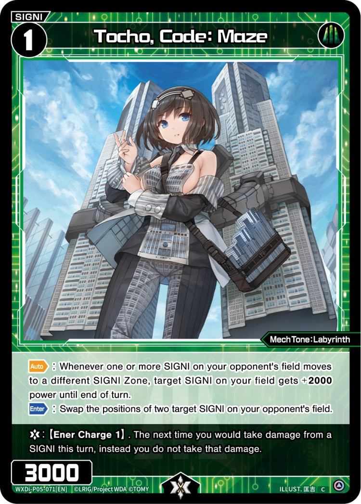

# Tocho, Code: Maze

## Thông tin lá

| Trường | Giá trị |
| --- | --- |
| Mã in | WXDi-P05-071[EN] |
| Set | WXDi-P05[EN] |
| Số thứ tự | 071 |
| Loại thẻ | SIGNI |
| Vị trí | Main Deck |
| Số bản | — (set booster, không áp dụng) |
| Màu | Xanh lá |
| Độ hiếm | C,C(P) |
| Minh họa | 匡吉 |
| Level | 1 |
| Limit | — |
| Power | 3000 |
| LRIG type / Class | Mech Tone：Labyrinth |
| Team / Master | — |
| Cost | — |
| Grow cost | — |
| Use timing | — |
| Life Burst | Có |

## Card text chính thức

[Auto]: Whenever one or more SIGNI on your opponent's field moves to a different SIGNI Zone, target SIGNI on your field gets +2000 power until end of turn.
[Enter]: Swap the positions of two target SIGNI on your opponent's field.

## Power text / Life Burst

【Ener Charge 1】. The next time you would take damage from a SIGNI this turn, instead you do not take that damage.

## Ghi chú minh họa
Artist: 匡吉. Ảnh C được tải từ Card List tiếng Anh.

## FAQ chính thức

**Q. I triggered this card's [Enter] ability and swapped the positions of two target my opponent's SIGNI. Does this card's [Auto] ability trigger?**
A. Yes, it is triggered. One or more SIGNI have moved at the same time, so in this case it is only triggered once.

## Ảnh biến thể

- [C(P)](../images/WXDi-P05-071P-EN.jpg)

## Nguồn
[Card List/FAQ chính thức](https://www.takaratomy.co.jp/products/en.wixoss/card/card.html?card_no=WXDi-P05-071%5BEN%5D ) · [Ảnh thẻ](https://www.takaratomy.co.jp/products/en.wixoss/card/thumb/WXDi-P05-071%5BEN%5D.jpg)
