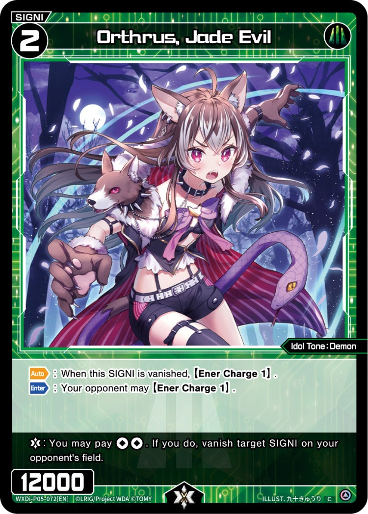

# Orthrus, Jade Evil

## Thông tin lá

| Trường | Giá trị |
| --- | --- |
| Mã in | WXDi-P05-072[EN] |
| Set | WXDi-P05[EN] |
| Số thứ tự | 072 |
| Loại thẻ | SIGNI |
| Vị trí | Main Deck |
| Số bản | — (set booster, không áp dụng) |
| Màu | Xanh lá |
| Độ hiếm | C,C(P) |
| Minh họa | 九十きゅうり |
| Level | 2 |
| Limit | — |
| Power | 12000 |
| LRIG type / Class | Idol Tone：Demon |
| Team / Master | — |
| Cost | — |
| Grow cost | — |
| Use timing | — |
| Life Burst | Có |

## Card text chính thức

[Auto]: When this SIGNI is vanished, 【Ener Charge 1】.
[Enter]: Your opponent may 【Ener Charge 1】.

## Power text / Life Burst

You may pay {Colorless} {Colorless}. If you do, vanish target SIGNI on your opponent's field.

## Ghi chú minh họa
Artist: 九十きゅうり. Ảnh C được tải từ Card List tiếng Anh.

## FAQ chính thức

**Q. Which player decides whether to perform 【Ener Charge 1】 in the [Enter] ability?**
A. This is a [Enter] ability without cost, so it must be triggered, and then the opponent of the player who put 《Orthrus, Jade Evil》 on the field decides whether the opponent will perform 【Ener Charge 1】.

## Ảnh biến thể

- [C(P)](../images/WXDi-P05-072P-EN.jpg)

## Nguồn
[Card List/FAQ chính thức](https://www.takaratomy.co.jp/products/en.wixoss/card/card.html?card_no=WXDi-P05-072%5BEN%5D ) · [Ảnh thẻ](https://www.takaratomy.co.jp/products/en.wixoss/card/thumb/WXDi-P05-072%5BEN%5D.jpg)
