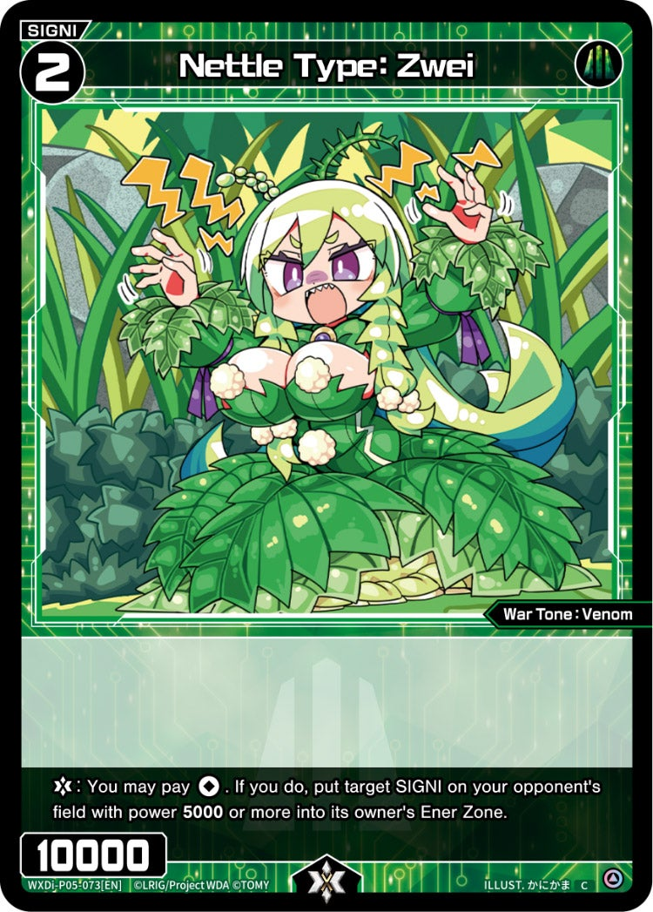

# Nettle Type: Zwei

## Thông tin lá

| Trường | Giá trị |
| --- | --- |
| Mã in | WXDi-P05-073[EN] |
| Set | WXDi-P05[EN] |
| Số thứ tự | 073 |
| Loại thẻ | SIGNI |
| Vị trí | Main Deck |
| Số bản | — (set booster, không áp dụng) |
| Màu | Xanh lá |
| Độ hiếm | C,C(P) |
| Minh họa | かにかま |
| Level | 2 |
| Limit | — |
| Power | 10000 |
| LRIG type / Class | War Tone：Venom |
| Team / Master | — |
| Cost | — |
| Grow cost | — |
| Use timing | — |
| Life Burst | Có |

## Card text chính thức

—

## Power text / Life Burst

You may pay {Colorless}. If you do, put target SIGNI on your opponent's field with power 5000 or more into its owner's Ener Zone.

## Ghi chú minh họa
Artist: かにかま. Ảnh C được tải từ Card List tiếng Anh.

## FAQ chính thức

**Q. May this SIGNI's Life Burst put target my opponent's SIGNI with the "cannot be vanished" ability into its owner's Ener Zone?**
A. Yes, you can. Both effects move a SIGNI from the field to the Ener Zone, but a distinction is made between "vanish" and "put into Ener Zone', and the "cannot be vanished" ability can only prevent the former.

## Ảnh biến thể

- [C(P)](../images/WXDi-P05-073P-EN.jpg)

## Nguồn
[Card List/FAQ chính thức](https://www.takaratomy.co.jp/products/en.wixoss/card/card.html?card_no=WXDi-P05-073%5BEN%5D ) · [Ảnh thẻ](https://www.takaratomy.co.jp/products/en.wixoss/card/thumb/WXDi-P05-073%5BEN%5D.jpg)
