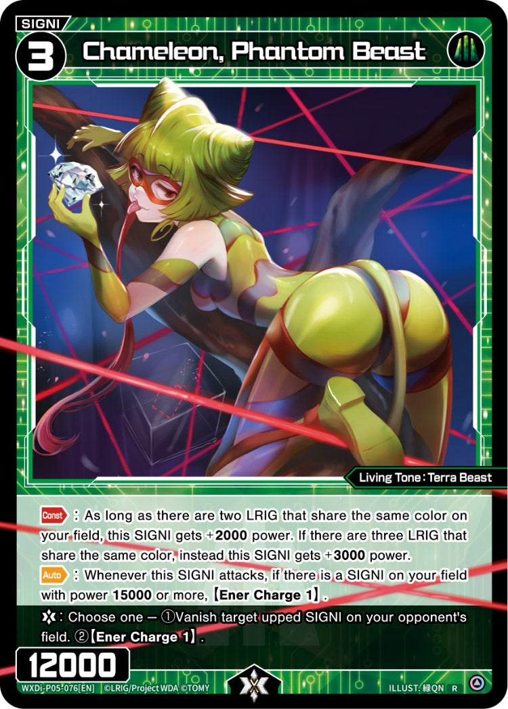

# Chameleon, Phantom Beast

## Thông tin lá

| Trường | Giá trị |
| --- | --- |
| Mã in | WXDi-P05-076[EN] |
| Set | WXDi-P05[EN] |
| Số thứ tự | 076 |
| Loại thẻ | SIGNI |
| Vị trí | Main Deck |
| Số bản | — (set booster, không áp dụng) |
| Màu | Xanh lá |
| Độ hiếm | R,R(P) |
| Minh họa | 緑QN |
| Level | 3 |
| Limit | — |
| Power | 12000 |
| LRIG type / Class | Living Tone：Terra Beast |
| Team / Master | — |
| Cost | — |
| Grow cost | — |
| Use timing | — |
| Life Burst | Có |

## Card text chính thức

[Constant]: As long as there are two LRIG that share the same color on your field, this SIGNI gets +2000 power. If there are three LRIG that share the same color, instead this SIGNI gets +3000 power.
[Auto]: Whenever this SIGNI attacks, if there is a SIGNI on your field with power 15000 or more, 【Ener Charge 1】.

## Power text / Life Burst

Choose one — ①Vanish target upped SIGNI on your opponent's field. ②【Ener Charge 1】.

## Ghi chú minh họa
Artist: 緑QN. Ảnh R được tải từ Card List tiếng Anh.

## FAQ chính thức

— (không có FAQ riêng cho mã này trên trang FAQ tiếng Anh.)

## Ảnh biến thể

- [R(P)](../images/WXDi-P05-076P-EN.jpg)

## Nguồn
[Card List/FAQ chính thức](https://www.takaratomy.co.jp/products/en.wixoss/card/card.html?card_no=WXDi-P05-076%5BEN%5D ) · [Ảnh thẻ](https://www.takaratomy.co.jp/products/en.wixoss/card/thumb/WXDi-P05-076%5BEN%5D.jpg)
