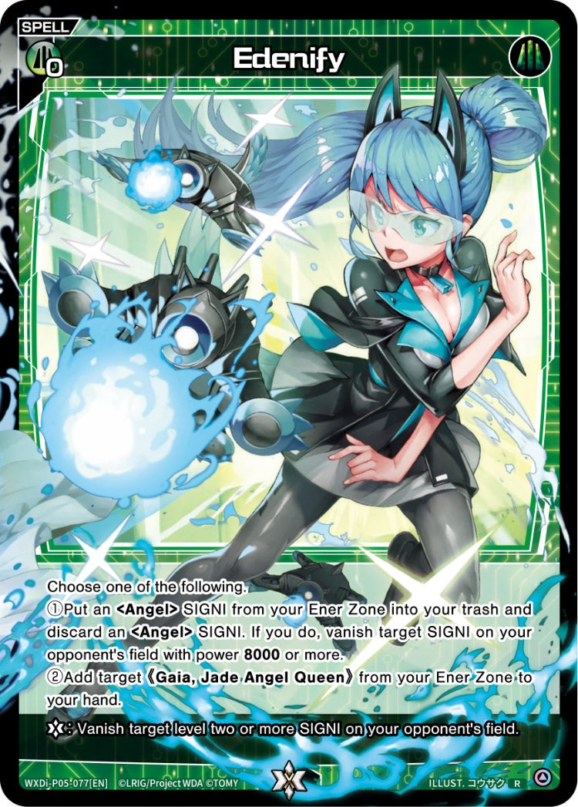

# Edenify

## Thông tin lá

| Trường | Giá trị |
| --- | --- |
| Mã in | WXDi-P05-077[EN] |
| Set | WXDi-P05[EN] |
| Số thứ tự | 077 |
| Loại thẻ | SPELL |
| Vị trí | Main Deck |
| Số bản | — (set booster, không áp dụng) |
| Màu | Xanh lá |
| Độ hiếm | R,R(P) |
| Minh họa | コウサク |
| Level | — |
| Limit | — |
| Power | 0 |
| LRIG type / Class | — |
| Team / Master | — |
| Cost | 《G》×０ |
| Grow cost | — |
| Use timing | — |
| Life Burst | Có |

## Card text chính thức

Choose one of the following.
①Put an <Angel> SIGNI from your Ener Zone into your trash and discard an <Angel> SIGNI. If you do, vanish target SIGNI on your opponent's field with power 8000 or more.
②Add target 《Gaia, Jade Angel Queen》 from your Ener Zone to your hand.

## Power text / Life Burst

Vanish target level two or more SIGNI on your opponent's field.

## Ghi chú minh họa
Artist: コウサク. Ảnh R được tải từ Card List tiếng Anh.

## FAQ chính thức

**Q. May I choose ① when there are zero cards in my hand or Ener Zone and put an <Angel> SIGNI from one side only into my trash to vanish my opponent's SIGNI?**
A. No, you cannot. You may choose ①, but if you cannot do both, you cannot put only one of them into your trash.

## Ảnh biến thể

- [R(P)](../images/WXDi-P05-077P-EN.jpg)

## Nguồn
[Card List/FAQ chính thức](https://www.takaratomy.co.jp/products/en.wixoss/card/card.html?card_no=WXDi-P05-077%5BEN%5D ) · [Ảnh thẻ](https://www.takaratomy.co.jp/products/en.wixoss/card/thumb/WXDi-P05-077%5BEN%5D.jpg)
