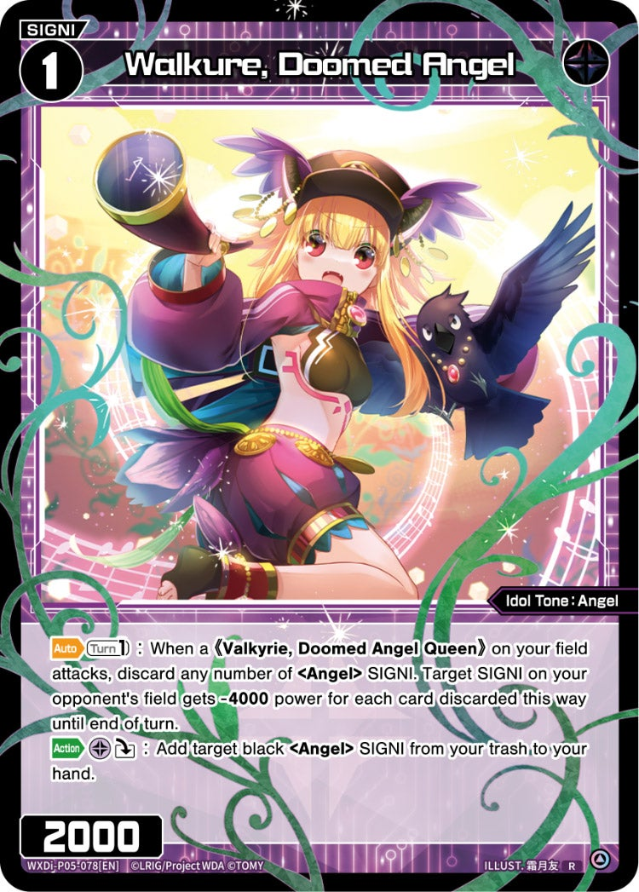

# Walkure, Doomed Angel

## Thông tin lá

| Trường | Giá trị |
| --- | --- |
| Mã in | WXDi-P05-078[EN] |
| Set | WXDi-P05[EN] |
| Số thứ tự | 078 |
| Loại thẻ | SIGNI |
| Vị trí | Main Deck |
| Số bản | — (set booster, không áp dụng) |
| Màu | Đen |
| Độ hiếm | R,R(P) |
| Minh họa | 霜月友 |
| Level | 1 |
| Limit | — |
| Power | 2000 |
| LRIG type / Class | Idol Tone：Angel |
| Team / Master | — |
| Cost | — |
| Grow cost | — |
| Use timing | — |
| Life Burst | Không |

## Card text chính thức

[Auto] {1/Turn}: When a 《Valkyrie, Doomed Angel Queen》 on your field attacks, discard any number of <Angel> SIGNI. Target SIGNI on your opponent's field gets -4000 power for each card discarded this way until end of turn.
[Action] {Black} {Down}: Add target black <Angel> SIGNI from your trash to your hand.

## Power text / Life Burst

—

## Ghi chú minh họa
Artist: 霜月友. Ảnh R được tải từ Card List tiếng Anh.

## FAQ chính thức

**Q. If there are two 《Valkyrie, Doomed Angel Queen》 on my field and one of them attacks, do both abilities trigger?**
A. Since the condition "When a 《Valkyrie, Doomed Angel Queen》 on your field attacks" is meet, each the [Auto] ability is triggered. But the [Auto] ability is limited to once per turn, even if another 《Valkyrie, Doomed Angel Queen》 attacks afterwards, neither of them will trigger.

## Ảnh biến thể

- [R(P)](../images/WXDi-P05-078P-EN.jpg)

## Nguồn
[Card List/FAQ chính thức](https://www.takaratomy.co.jp/products/en.wixoss/card/card.html?card_no=WXDi-P05-078%5BEN%5D ) · [Ảnh thẻ](https://www.takaratomy.co.jp/products/en.wixoss/card/thumb/WXDi-P05-078%5BEN%5D.jpg)
