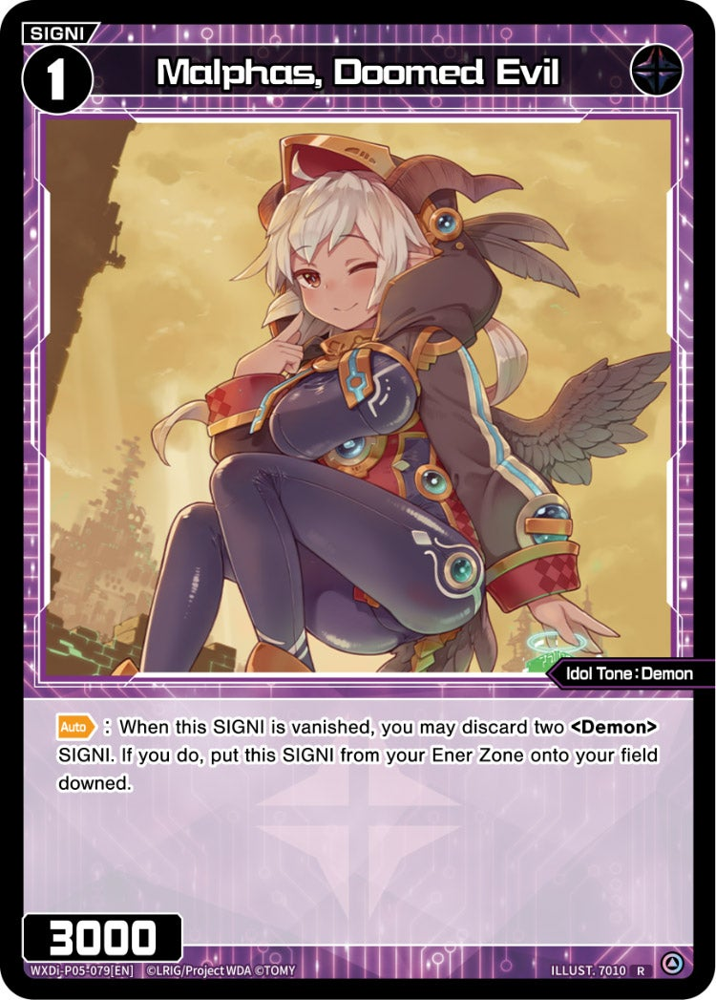

# Malphas, Doomed Evil

## Thông tin lá

| Trường | Giá trị |
| --- | --- |
| Mã in | WXDi-P05-079[EN] |
| Set | WXDi-P05[EN] |
| Số thứ tự | 079 |
| Loại thẻ | SIGNI |
| Vị trí | Main Deck |
| Số bản | — (set booster, không áp dụng) |
| Màu | Đen |
| Độ hiếm | R,R(P) |
| Minh họa | 7010 |
| Level | 1 |
| Limit | — |
| Power | 3000 |
| LRIG type / Class | Idol Tone：Demon |
| Team / Master | — |
| Cost | — |
| Grow cost | — |
| Use timing | — |
| Life Burst | Không |

## Card text chính thức

[Auto]: When this SIGNI is vanished, you may discard two <Demon> SIGNI. If you do, put this SIGNI from your Ener Zone onto your field downed.

## Power text / Life Burst

—

## Ghi chú minh họa
Artist: 7010. Ảnh R được tải từ Card List tiếng Anh.

## FAQ chính thức

**Q. When put this SIGNI onto my field from my Ener Zone by its [Auto] ability, does put it onto the SIGNI Zone that was originally there?**
A. No, you may put it onto any SIGNI Zone as long as your SIGNI is not placed there.

**Q. When this SIGNI was vanished by my opponent's 《Chandelier, Code: Art》 [Constant] ability, etc., it was put into my trash instead of being put into my Ener Zone. May I put this SIGNI onto my field by this card's [Auto] ability?**
A. No, this [Auto] ability is an effect that put this card onto the field from the Ener Zone, so if this card is put outside your Ener Zone (in this case, in your trash) when this ability is triggered, cannot be put it onto your field.

## Ảnh biến thể

- [R(P)](../images/WXDi-P05-079P-EN.jpg)

## Nguồn
[Card List/FAQ chính thức](https://www.takaratomy.co.jp/products/en.wixoss/card/card.html?card_no=WXDi-P05-079%5BEN%5D ) · [Ảnh thẻ](https://www.takaratomy.co.jp/products/en.wixoss/card/thumb/WXDi-P05-079%5BEN%5D.jpg)
