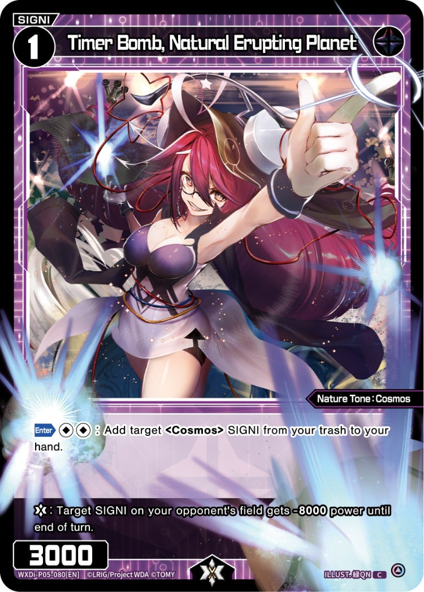

# Timer Bomb, Natural Erupting Planet

## Thông tin lá

| Trường | Giá trị |
| --- | --- |
| Mã in | WXDi-P05-080[EN] |
| Set | WXDi-P05[EN] |
| Số thứ tự | 080 |
| Loại thẻ | SIGNI |
| Vị trí | Main Deck |
| Số bản | — (set booster, không áp dụng) |
| Màu | Đen |
| Độ hiếm | C,C(P) |
| Minh họa | 緑QN |
| Level | 1 |
| Limit | — |
| Power | 3000 |
| LRIG type / Class | Nature Tone：Cosmos |
| Team / Master | — |
| Cost | — |
| Grow cost | — |
| Use timing | — |
| Life Burst | Có |

## Card text chính thức

[Enter] {Colorless} {Colorless}: Add target <Cosmos> SIGNI from your trash to your hand.

## Power text / Life Burst

Target SIGNI on your opponent's field gets -8000 power until end of turn.

## Ghi chú minh họa
Artist: 緑QN. Ảnh C được tải từ Card List tiếng Anh.

## FAQ chính thức

**Q. May a card paid as the Ener cost of the [Enter] ability be targeted by this effect and put it into my hand?**
A. Yes, you can. You may put target card into your hand as long as it meets the conditions after you paid the Ener cost of the [Enter] ability.

## Ảnh biến thể

- [C(P)](../images/WXDi-P05-080P-EN.jpg)

## Nguồn
[Card List/FAQ chính thức](https://www.takaratomy.co.jp/products/en.wixoss/card/card.html?card_no=WXDi-P05-080%5BEN%5D ) · [Ảnh thẻ](https://www.takaratomy.co.jp/products/en.wixoss/card/thumb/WXDi-P05-080%5BEN%5D.jpg)
