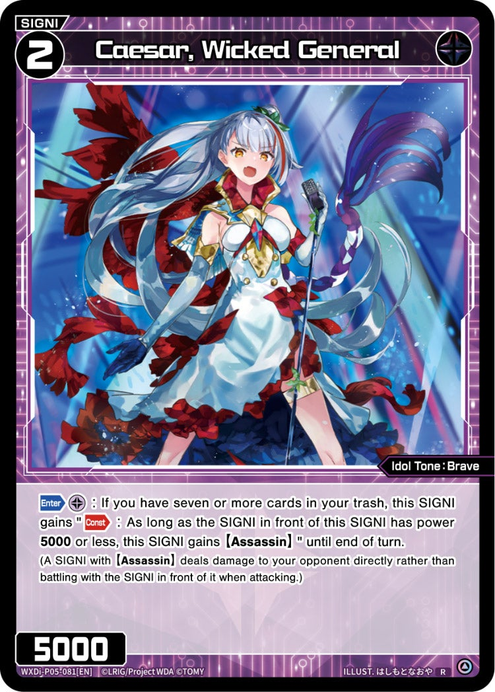

# Caesar, Wicked General

## Thông tin lá

| Trường | Giá trị |
| --- | --- |
| Mã in | WXDi-P05-081[EN] |
| Set | WXDi-P05[EN] |
| Số thứ tự | 081 |
| Loại thẻ | SIGNI |
| Vị trí | Main Deck |
| Số bản | — (set booster, không áp dụng) |
| Màu | Đen |
| Độ hiếm | R,R(P) |
| Minh họa | はしもとなおや |
| Level | 2 |
| Limit | — |
| Power | 5000 |
| LRIG type / Class | Idol Tone：Brave |
| Team / Master | — |
| Cost | — |
| Grow cost | — |
| Use timing | — |
| Life Burst | Không |

## Card text chính thức

[Enter] {Black}: If you have seven or more cards in your trash, this SIGNI gains "[Constant]: As long as the SIGNI in front of this SIGNI has power 5000 or less, this SIGNI gains 【Assassin】" until end of turn.
(A SIGNI with 【Assassin】 deals damage to your opponent directly rather than battling with the SIGNI in front of it when attacking.)

## Power text / Life Burst

—

## Ghi chú minh họa
Artist: はしもとなおや. Ảnh R được tải từ Card List tiếng Anh.

## FAQ chính thức

**Q. I put this SIGNI on my field when there are six cards in my trash. If I pay the Ener Cost of the [Enter] ability and become seven cards in my trash, does this SIGNI gain the [Constant] ability?**
A. Yes, it can gain. This ability checks the number of cards in your trash after paying the Ener Cost of the [Enter] ability.

**Q. There are zero cards in my trash, but I put this SIGNI on my field and paid the Ener Cost of the [Enter] ability. Afterwards due to some effect, there are more cards in my trash and seven or more cards in my trash. Does this SIGNI gain the [Constant] ability?**
A. No, it cannot gain. This ability checks the number of cards in your trash when you paid the Ener Cost and it is triggered. If there are seven or more cards at that time, this card gains the [Constant] ability, otherwise it cannot gain the [Constant] ability even if number of cards in your trash increases at a later time.

**Q. I put this SIGNI on my field, triggered the [Enter] ability and gained the [Constant] ability. Then if a SIGNI with power 5000 or less enters in front of it, does it gain 【Assassin】? Also, what happens if that SIGNI's power is added?**
A. The [Constant] ability gained by this [Enter] ability always checks "whether there is a Signi with power 5000 or less in front of this card", and if it meets the condition, it gains 【Assassin】 immediately, and if it no longer meets the condition, it loses 【Assassin】 immediately. For example, if a SIGNI with 5000 or less power enters in front of this card, this card gain 【Assassin】 at the this time and if power of a SIGNI is added and is no longer 5000 or less, you lose 【Assassin】 immediately.

## Ảnh biến thể

- [R(P)](../images/WXDi-P05-081P-EN.jpg)

## Nguồn
[Card List/FAQ chính thức](https://www.takaratomy.co.jp/products/en.wixoss/card/card.html?card_no=WXDi-P05-081%5BEN%5D ) · [Ảnh thẻ](https://www.takaratomy.co.jp/products/en.wixoss/card/thumb/WXDi-P05-081%5BEN%5D.jpg)
