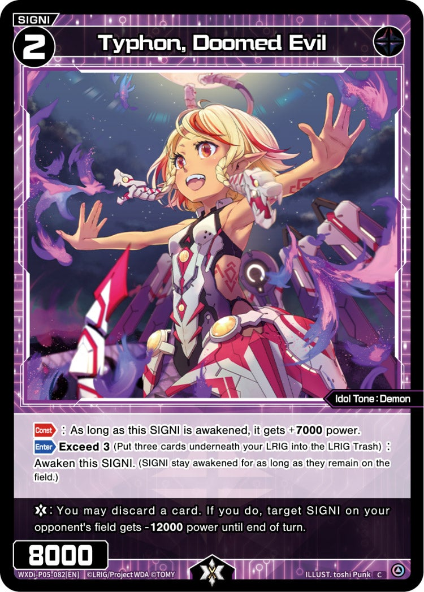

# Typhon, Doomed Evil

## Thông tin lá

| Trường | Giá trị |
| --- | --- |
| Mã in | WXDi-P05-082[EN] |
| Set | WXDi-P05[EN] |
| Số thứ tự | 082 |
| Loại thẻ | SIGNI |
| Vị trí | Main Deck |
| Số bản | — (set booster, không áp dụng) |
| Màu | Đen |
| Độ hiếm | C,C(P) |
| Minh họa | toshi Punk |
| Level | 2 |
| Limit | — |
| Power | 8000 |
| LRIG type / Class | Idol Tone：Demon |
| Team / Master | — |
| Cost | — |
| Grow cost | — |
| Use timing | — |
| Life Burst | Có |

## Card text chính thức

[Constant]: As long as this SIGNI is awakened, it gets +7000 power.
[Enter] Exceed 3 (Put three cards underneath your LRIG into the LRIG Trash): Awaken this SIGNI. (SIGNI stay awakened for as long as they remain on the field.)

## Power text / Life Burst

You may discard a card. If you do, target SIGNI on your opponent's field gets -12000 power until end of turn.

## Ghi chú minh họa
Artist: toshi Punk. Ảnh C được tải từ Card List tiếng Anh.

## FAQ chính thức

**Q. What is "awakened"?**
A. SIGNI may be awakened by the effect of SIGNI and gain an awakened state. An awakened SIGNI remains awakened for as long as that SIGNI on the field, even if the Turn Player changes. If this card is moved to another zone, such as the hand, and then put onto your field again, or if it is turned face down with the effect of 《Robin Hood, Jade General Queen》, etc. and then returned to face up, it is lose awakened state.

## Ảnh biến thể

- [C(P)](../images/WXDi-P05-082P-EN.jpg)

## Nguồn
[Card List/FAQ chính thức](https://www.takaratomy.co.jp/products/en.wixoss/card/card.html?card_no=WXDi-P05-082%5BEN%5D ) · [Ảnh thẻ](https://www.takaratomy.co.jp/products/en.wixoss/card/thumb/WXDi-P05-082%5BEN%5D.jpg)
