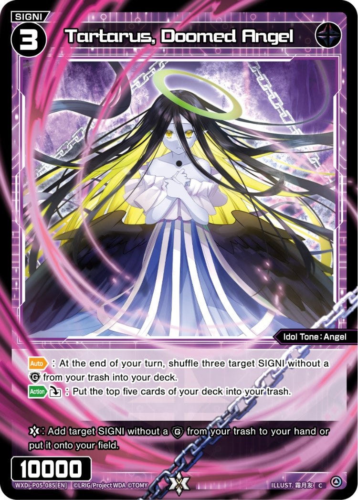

# Tartarus, Doomed Angel

## Thông tin lá

| Trường | Giá trị |
| --- | --- |
| Mã in | WXDi-P05-085[EN] |
| Set | WXDi-P05[EN] |
| Số thứ tự | 085 |
| Loại thẻ | SIGNI |
| Vị trí | Main Deck |
| Số bản | — (set booster, không áp dụng) |
| Màu | Đen |
| Độ hiếm | C,C(P) |
| Minh họa | 霜月友 |
| Level | 3 |
| Limit | — |
| Power | 10000 |
| LRIG type / Class | Idol Tone：Angel |
| Team / Master | — |
| Cost | — |
| Grow cost | — |
| Use timing | — |
| Life Burst | Có |

## Card text chính thức

[Auto]: At the end of your turn, shuffle three target SIGNI without a {Guard Icon} from your trash into your deck.
[Action] {Down}: Put the top five cards of your deck into your trash.

## Power text / Life Burst

Add target SIGNI without a {Guard Icon} from your trash to your hand or put it onto your field.

## Ghi chú minh họa
Artist: 霜月友. Ảnh C được tải từ Card List tiếng Anh.

## FAQ chính thức

**Q. At the end of this turn, may I put two SIGNI without a {Guard Icon} into my deck from my trash if there are only two SIGNI without a {Guard Icon} in my trash?**
A. No, you cannot. If three cards that meet the conditions cannot be targeted, none of them can be targeted. Also you cannot perform to shuffle your deck.

## Ảnh biến thể

- [C(P)](../images/WXDi-P05-085P-EN.jpg)

## Nguồn
[Card List/FAQ chính thức](https://www.takaratomy.co.jp/products/en.wixoss/card/card.html?card_no=WXDi-P05-085%5BEN%5D ) · [Ảnh thẻ](https://www.takaratomy.co.jp/products/en.wixoss/card/thumb/WXDi-P05-085%5BEN%5D.jpg)
