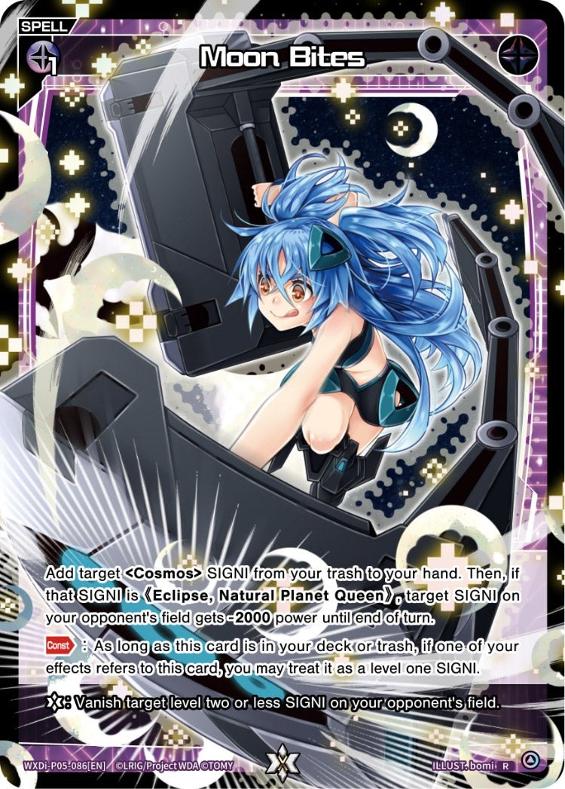

# Moon Bites

## Thông tin lá

| Trường | Giá trị |
| --- | --- |
| Mã in | WXDi-P05-086[EN] |
| Set | WXDi-P05[EN] |
| Số thứ tự | 086 |
| Loại thẻ | SPELL |
| Vị trí | Main Deck |
| Số bản | — (set booster, không áp dụng) |
| Màu | Đen |
| Độ hiếm | R,R(P) |
| Minh họa | bomi |
| Level | — |
| Limit | — |
| Power | 0 |
| LRIG type / Class | — |
| Team / Master | — |
| Cost | 《B》×１ |
| Grow cost | — |
| Use timing | — |
| Life Burst | Có |

## Card text chính thức

Add target <Cosmos> SIGNI from your trash to your hand. Then, if that SIGNI is 《Eclipse, Natural Planet Queen》, target SIGNI on your opponent's field gets -2000 power until end of turn.

[Constant]: As long as this card is in your deck or trash, if one of your effects refers to this card, you may treat it as a level one SIGNI.

## Power text / Life Burst

Vanish target level two or less SIGNI on your opponent's field.

## Ghi chú minh họa
Artist: bomi. Ảnh R được tải từ Card List tiếng Anh.

## FAQ chính thức

**Q. What exactly is the [Constant] ability?**
A. For example, you can put this card into your hand with an effect such as "Search your deck for a level one SIGNI, reveal it and put it into your hand". If you treat it as a level one SIGNI, you cannot treat it as a spell at the same time by the same effect. The information on the card is followed, except that it is a level one SIGNI, so this SIGNI is black and has no class or power. If you choose to put it onto the field as an effect, it does not enter on the field, but stays in its original zone.

## Ảnh biến thể

- [R(P)](../images/WXDi-P05-086P-EN.jpg)

## Nguồn
[Card List/FAQ chính thức](https://www.takaratomy.co.jp/products/en.wixoss/card/card.html?card_no=WXDi-P05-086%5BEN%5D ) · [Ảnh thẻ](https://www.takaratomy.co.jp/products/en.wixoss/card/thumb/WXDi-P05-086%5BEN%5D.jpg)
