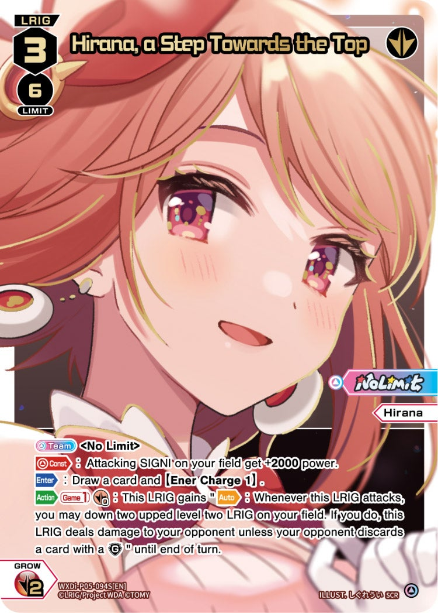

# Hirana, a Step Towards the Top

## Thông tin lá

| Trường | Giá trị |
| --- | --- |
| Mã in | WXDi-P05-094S[EN] |
| Set | WXDi-P05[EN] |
| Số thứ tự | 094S |
| Loại thẻ | LRIG |
| Vị trí | LRIG Deck |
| Số bản | — (set booster, không áp dụng) |
| Màu | Đỏ |
| Độ hiếm | SCR |
| Minh họa | しぐれうい |
| Level | 3 |
| Limit | 6 |
| Power | 0 |
| LRIG type / Class | Hirana |
| Team / Master | No Limit |
| Cost | — |
| Grow cost | 《R》×２ |
| Use timing | — |
| Life Burst | Không |

## Card text chính thức

[Team] <No Limit>
[Team Constant]: Attacking SIGNI on your field get +2000 power.
[Enter]: Draw a card and 【Ener Charge 1】.
[Action] {1/Game} {Redx0}: This LRIG gains "[Auto]: Whenever this LRIG attacks, you may down two upped level two LRIG on your field. If you do, this LRIG deals damage to your opponent unless your opponent discards a card with a {Guard Icon}" until end of turn.

## Power text / Life Burst

—

## Ghi chú minh họa
Artist: しぐれうい. Ảnh SCR được tải từ Card List tiếng Anh.

## FAQ chính thức

— (không có FAQ riêng cho mã này trên trang FAQ tiếng Anh.)

## Nguồn
[Card List/FAQ chính thức](https://www.takaratomy.co.jp/products/en.wixoss/card/card.html?card_no=WXDi-P05-094S%5BEN%5D ) · [Ảnh thẻ](https://www.takaratomy.co.jp/products/en.wixoss/card/thumb/WXDi-P05-094S%5BEN%5D.jpg)
