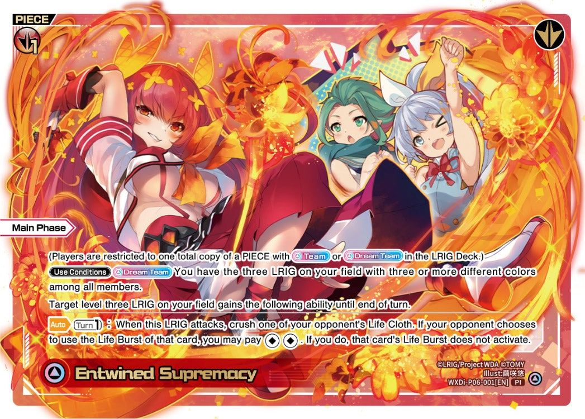

# Entwined Supremacy

## Thông tin lá

| Trường | Giá trị |
| --- | --- |
| Mã in | WXDi-P06-001[EN] |
| Set | WXDi-P06[EN] |
| Số thứ tự | 001 |
| Loại thẻ | PIECE |
| Vị trí | LRIG Deck |
| Số bản | — (set booster, không áp dụng) |
| Màu | Đỏ |
| Độ hiếm | PI,LRP |
| Minh họa | 繭咲悠 |
| Level | — |
| Limit | — |
| Power | 0 |
| LRIG type / Class | — |
| Team / Master | — |
| Cost | 《R》×１ |
| Grow cost | — |
| Use timing | Main Phase |
| Life Burst | Không |

## Card text chính thức

(Players are restricted to one total copy of a PIECE with [Team] or [Dream Team] in the LRIG Deck.)
[Use Conditions] [Dream Team] You have the three LRIG on your field with three or more different colors among all members.

Target level three LRIG on your field gains the following ability until end of turn.
『[Auto] {1/Turn}: When this LRIG attacks, crush one of your opponent's Life Cloth. If your opponent chooses to use the Life Burst of that card, you may pay {Colorless} {Colorless}. If you do, that card's Life Burst does not activate.』

## Power text / Life Burst

—

## Ghi chú minh họa
Artist: 繭咲悠. Ảnh PI được tải từ Card List tiếng Anh.

## FAQ chính thức

**Q. What is [Dream Team]?**
A. [Dream Team] is a PIECE that can be used if certain conditions listed there are met.
Note that PIECE with [Dream Team] icon cannot be put in the LRIG deck together with PIECE with [Team] and [Dream Team] icons.
(= total limit of one PIECE).
For example, if you include one PIECE with [Dream Team] icon, you can only include another PIECE with neither icon.

**Q. When I use this card and attack with a LRIG that has gained an ability, what are the specific steps to handle the ability?**
A. When you attack with this LRIG, before your opponent use 【Guard】 or deal damage, the [Auto] ability "When this LRIG attacks" is triggered, you crush one of your opponent's Life Cloth. Check it in the Check Zone and your opponent chooses whether or not to activate that Life Burst. If your opponent choose to activate it, you choose whether to pay {Colourless} {Colourless}. If you pay it, it is put into the Ener Zone without triggering, if you don't pay it, the Life Burst is triggered. You then enter the normal attack procedure and decide whether to 【Guard】 the attack.

## Ảnh biến thể

- [LRP](../images/WXDi-P06-001P-EN.jpg)

## Nguồn
[Card List/FAQ chính thức](https://www.takaratomy.co.jp/products/en.wixoss/card/card.html?card_no=WXDi-P06-001%5BEN%5D ) · [Ảnh thẻ](https://www.takaratomy.co.jp/products/en.wixoss/card/thumb/WXDi-P06-001%5BEN%5D.jpg)
