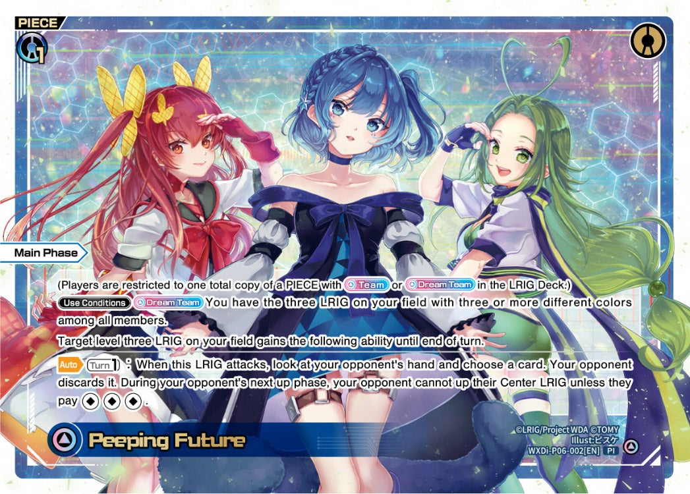

# Peeping Future

## Thông tin lá

| Trường | Giá trị |
| --- | --- |
| Mã in | WXDi-P06-002[EN] |
| Set | WXDi-P06[EN] |
| Số thứ tự | 002 |
| Loại thẻ | PIECE |
| Vị trí | LRIG Deck |
| Số bản | — (set booster, không áp dụng) |
| Màu | Xanh dương |
| Độ hiếm | PI,LRP |
| Minh họa | ピスケ |
| Level | — |
| Limit | — |
| Power | 0 |
| LRIG type / Class | — |
| Team / Master | — |
| Cost | 《U》×１ |
| Grow cost | — |
| Use timing | Main Phase |
| Life Burst | Không |

## Card text chính thức

(Players are restricted to one total copy of a PIECE with [Team] or [Dream Team] in the LRIG Deck.)
[Use Conditions] [Dream Team] You have the three LRIG on your field with three or more different colors among all members.

Target level three LRIG on your field gains the following ability until end of turn.
『[Auto] {1/Turn}: When this LRIG attacks, look at your opponent's hand and choose a card. Your opponent discards it. During your opponent's next up phase, your opponent cannot up their Center LRIG unless they pay {Colorless} {Colorless} {Colorless}.』

## Power text / Life Burst

—

## Ghi chú minh họa
Artist: ピスケ. Ảnh PI được tải từ Card List tiếng Anh.

## FAQ chính thức

**Q. What is [Dream Team]?**
A. [Dream Team] is a PIECE that can be used if certain conditions listed there are met.
Note that PIECE with [Dream Team] icon cannot be put in the LRIG deck together with PIECE with [Team] and [Dream Team] icons.
(= total limit of one PIECE).
For example, if you include one PIECE with [Dream Team] icon, you can only include another PIECE with neither icon.

**Q. When I use this card and attack with a LRIG that has gained an ability, There are no cards in my opponent's hand and cannot discard any. What happens to the latter half of the effect?**
A. Even if your opponent is not forced to discard your opponent's hand, the latter half of the effect is processed and your opponent's center LRIG will not be up unless the your opponent pays {Colourless} {Colourless} {Colourless}.

## Ảnh biến thể

- [LRP](../images/WXDi-P06-002P-EN.jpg)

## Nguồn
[Card List/FAQ chính thức](https://www.takaratomy.co.jp/products/en.wixoss/card/card.html?card_no=WXDi-P06-002%5BEN%5D ) · [Ảnh thẻ](https://www.takaratomy.co.jp/products/en.wixoss/card/thumb/WXDi-P06-002%5BEN%5D.jpg)
