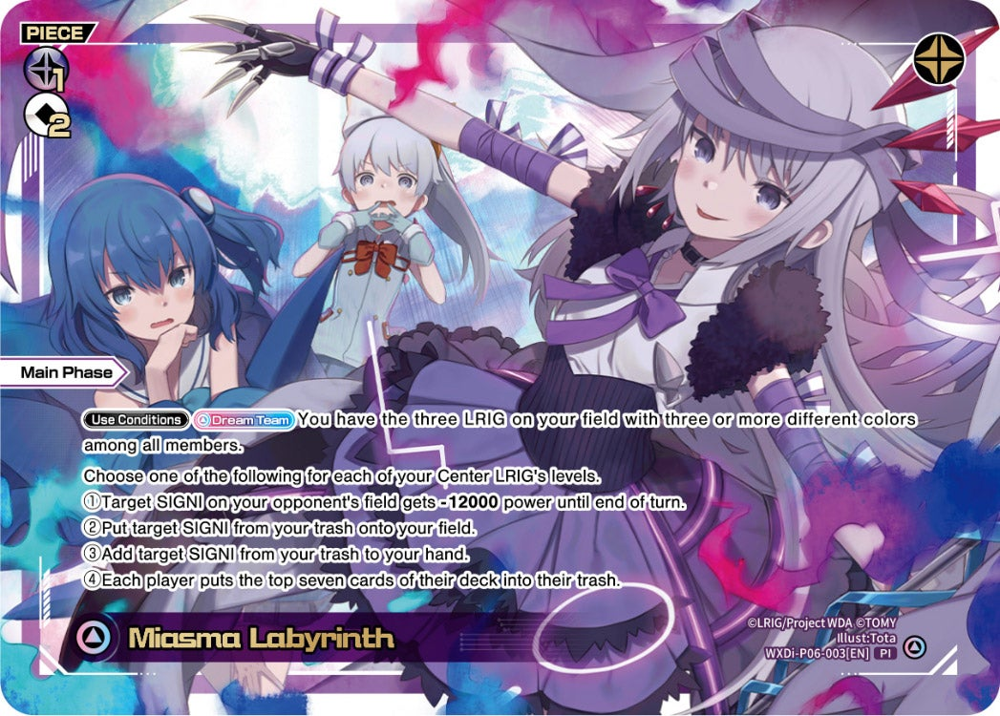

# Miasma Labyrinth

## Thông tin lá

| Trường | Giá trị |
| --- | --- |
| Mã in | WXDi-P06-003[EN] |
| Set | WXDi-P06[EN] |
| Số thứ tự | 003 |
| Loại thẻ | PIECE |
| Vị trí | LRIG Deck |
| Số bản | — (set booster, không áp dụng) |
| Màu | Đen |
| Độ hiếm | PI,LRP |
| Minh họa | Tota |
| Level | — |
| Limit | — |
| Power | 0 |
| LRIG type / Class | — |
| Team / Master | — |
| Cost | 《B》×１ / 《C》×２ |
| Grow cost | — |
| Use timing | Main Phase |
| Life Burst | Không |

## Card text chính thức

[Use Conditions] [Dream Team] You have the three LRIG on your field with three or more different colors among all members.

Choose one of the following for each of your Center LRIG's levels.
①Target SIGNI on your opponent's field gets -12000 power until end of turn.
②Put target SIGNI from your trash onto your field.
③Add target SIGNI from your trash to your hand.
④Each player puts the top seven cards of their deck into their trash.

## Power text / Life Burst

—

## Ghi chú minh họa
Artist: Tota. Ảnh PI được tải từ Card List tiếng Anh.

## FAQ chính thức

**Q. What is [Dream Team]?**
A. [Dream Team] is a PIECE that can be used if certain conditions listed there are met.
Note that PIECE with [Dream Team] icon cannot be put in the LRIG deck together with PIECE with [Team] and [Dream Team] icons.
(= total limit of one PIECE).
For example, if you include one PIECE with [Dream Team] icon, you can only include another PIECE with neither icon.

**Q. I chose ②, ③ and ④ when the center LRIG is level three. May I process with ④ first and put seven cards from the top of my deck into my trash, then choose a SIGNI in my trash with ② or ③?**
A. No, you cannot. This effect is processed in order from the top, so the last to be put seven cards from top of your deck into your trash.

**Q. If the center LRIG is at level five, how many options may be chosen?**
A. You cannot choose the same option more than once, and you can choose up to four.

## Ảnh biến thể

- [LRP](../images/WXDi-P06-003P-EN.jpg)

## Nguồn
[Card List/FAQ chính thức](https://www.takaratomy.co.jp/products/en.wixoss/card/card.html?card_no=WXDi-P06-003%5BEN%5D ) · [Ảnh thẻ](https://www.takaratomy.co.jp/products/en.wixoss/card/thumb/WXDi-P06-003%5BEN%5D.jpg)
