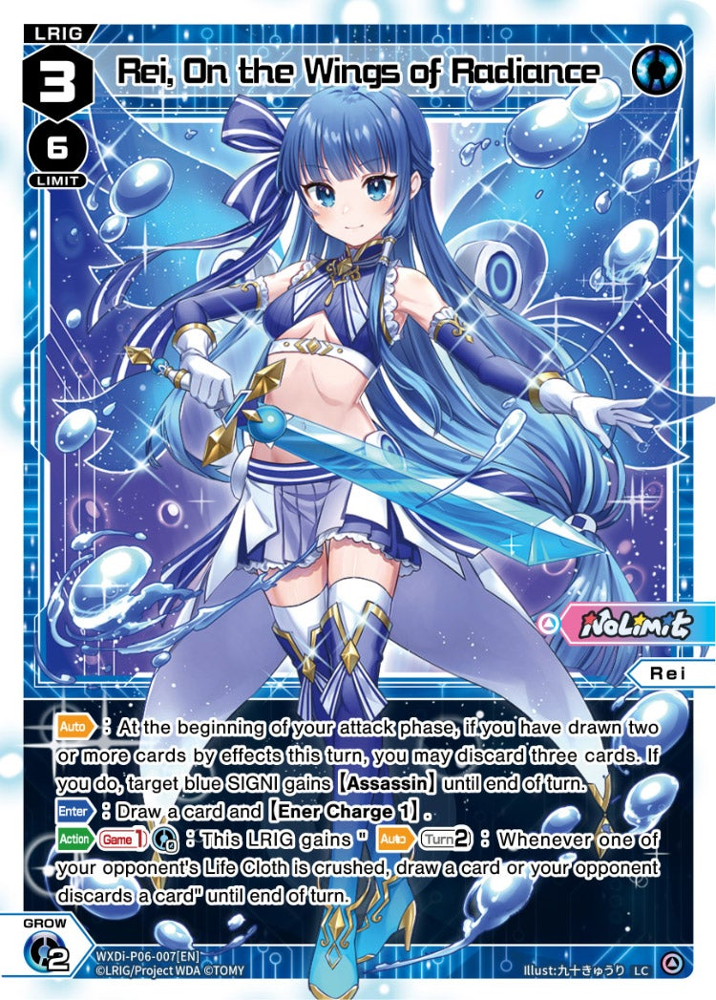

# Rei, On the Wings of Radiance

## Thông tin lá

| Trường | Giá trị |
| --- | --- |
| Mã in | WXDi-P06-007[EN] |
| Set | WXDi-P06[EN] |
| Số thứ tự | 007 |
| Loại thẻ | LRIG |
| Vị trí | LRIG Deck |
| Số bản | — (set booster, không áp dụng) |
| Màu | Xanh dương |
| Độ hiếm | LC,LR,LRP,UR |
| Minh họa | 九十きゅうり |
| Level | 3 |
| Limit | 6 |
| Power | 0 |
| LRIG type / Class | Rei |
| Team / Master | No Limit |
| Cost | — |
| Grow cost | 《U》×２ |
| Use timing | — |
| Life Burst | Không |

## Card text chính thức

[Auto]: At the beginning of your attack phase, if you have drawn two or more cards by effects this turn, you may discard three cards. If you do, target blue SIGNI gains 【Assassin】 until end of turn.
[Enter]: Draw a card and 【Ener Charge 1】.
[Action] {1/Game} {Bluex0}: This LRIG gains "[Auto] {2/Turn}: Whenever one of your opponent's Life Cloth is crushed, draw a card or your opponent discards a card" until end of turn.

## Power text / Life Burst

—

## Ghi chú minh họa
Artist: 九十きゅうり. Ảnh LC được tải từ Card List tiếng Anh.

## FAQ chính thức

**Q. If a card is searched from my deck and added to my hand by an effect, or if a card is added to your hand from my trash or Ener zone by an effect, does this meet the condition of the [Auto] ability "if you have drawn two or more cards by effects"?**
A. No, only if the effect says "draw" and a card is drawn does this condition apply.

**Q. This LRIG gained the [Auto] ability through this LRIG's [Action] Ability. If two of my opponent's Life Cloth are crushed at the same time by 【Double Crush】 during that turn, does the [Auto] ability trigger?**
A. Yes, two cards have been crushed and will be triggered twice.

**Q. Which triggers first, the [Auto] ability "Whenever one of your opponent's Life Cloth is crushed" or the Life Burst of the crushed card?**
A. They trigger at the same time and are triggered from the turn player's ability first. If you crushed because you attacked, you are the turn player, so the [Auto] ability triggers first.

## Ảnh biến thể

- [LRP](../images/WXDi-P06-007P-EN.jpg)
- [LR](../images/WXDi-P06-007R-EN.jpg)
- [UR](../images/WXDi-P06-007U-EN.jpg)

## Nguồn
[Card List/FAQ chính thức](https://www.takaratomy.co.jp/products/en.wixoss/card/card.html?card_no=WXDi-P06-007%5BEN%5D ) · [Ảnh thẻ](https://www.takaratomy.co.jp/products/en.wixoss/card/thumb/WXDi-P06-007%5BEN%5D.jpg)
