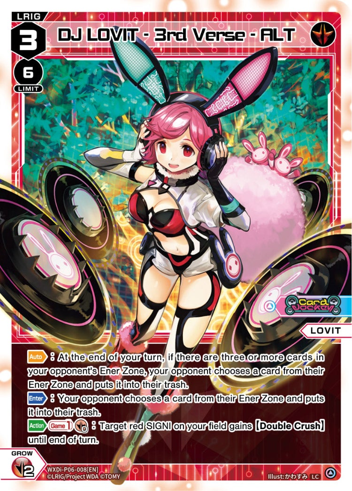

# DJ LOVIT - 3rd Verse - ALT

## Thông tin lá

| Trường | Giá trị |
| --- | --- |
| Mã in | WXDi-P06-008[EN] |
| Set | WXDi-P06[EN] |
| Số thứ tự | 008 |
| Loại thẻ | LRIG |
| Vị trí | LRIG Deck |
| Số bản | — (set booster, không áp dụng) |
| Màu | Đỏ |
| Độ hiếm | LC,LR,LRP,UR |
| Minh họa | かわすみ |
| Level | 3 |
| Limit | 6 |
| Power | 0 |
| LRIG type / Class | LOVIT |
| Team / Master | Card Jockey |
| Cost | — |
| Grow cost | 《R》×２ |
| Use timing | — |
| Life Burst | Không |

## Card text chính thức

[Auto]: At the end of your turn, if there are three or more cards in your opponent's Ener Zone, your opponent chooses a card from their Ener Zone and puts it into their trash.
[Enter]: Your opponent chooses a card from their Ener Zone and puts it into their trash.
[Action] {1/Game} {Redx0}: Target red SIGNI on your field gains 【Double Crush】 until end of turn.

## Power text / Life Burst

—

## Ghi chú minh họa
Artist: かわすみ. Ảnh LC được tải từ Card List tiếng Anh.

## FAQ chính thức

— (không có FAQ riêng cho mã này trên trang FAQ tiếng Anh.)

## Ảnh biến thể

- [LRP](../images/WXDi-P06-008P-EN.jpg)
- [LR](../images/WXDi-P06-008R-EN.jpg)
- [UR](../images/WXDi-P06-008U-EN.jpg)

## Nguồn
[Card List/FAQ chính thức](https://www.takaratomy.co.jp/products/en.wixoss/card/card.html?card_no=WXDi-P06-008%5BEN%5D ) · [Ảnh thẻ](https://www.takaratomy.co.jp/products/en.wixoss/card/thumb/WXDi-P06-008%5BEN%5D.jpg)
