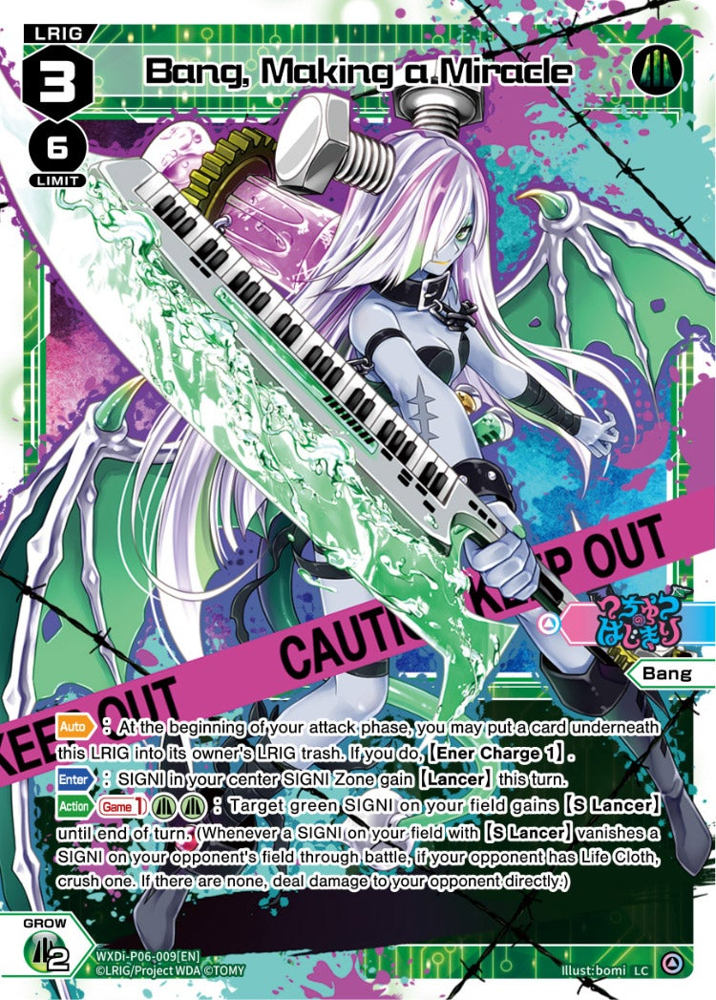

# Bang, Making a Miracle

## Thông tin lá

| Trường | Giá trị |
| --- | --- |
| Mã in | WXDi-P06-009[EN] |
| Set | WXDi-P06[EN] |
| Số thứ tự | 009 |
| Loại thẻ | LRIG |
| Vị trí | LRIG Deck |
| Số bản | — (set booster, không áp dụng) |
| Màu | Xanh lá |
| Độ hiếm | LC,LR,LRP,UR |
| Minh họa | bomi |
| Level | 3 |
| Limit | 6 |
| Power | 0 |
| LRIG type / Class | Bang |
| Team / Master | UCHU NO HAJIMARI |
| Cost | — |
| Grow cost | 《G》×２ |
| Use timing | — |
| Life Burst | Không |

## Card text chính thức

[Auto]: At the beginning of your attack phase, you may put a card underneath this LRIG into its owner's LRIG trash. If you do, 【Ener Charge 1】.
[Enter]: SIGNI in your center SIGNI Zone gain 【Lancer】 this turn.
[Action] {1/Game} {Green} {Green}: Target green SIGNI on your field gains 【S Lancer】 until end of turn. (Whenever a SIGNI on your field with 【S Lancer】 vanishes a SIGNI on your opponent's field through battle, if your opponent has Life Cloth, crush one. If there are none, deal damage to your opponent directly.)

## Power text / Life Burst

—

## Ghi chú minh họa
Artist: bomi. Ảnh LC được tải từ Card List tiếng Anh.

## FAQ chính thức

**Q. In the [Enter] ability, does a SIGNI that later enters the center SIGNI zone after the [Enter] ability is resolved also gain 【Lancer】?**
A. Yes, your SIGNI gain 【Lancer】 for this turn, regardless of whether it was originally in the center SIGNI zone or came out later. However, if you move from the center SIGNI zone to the right or left SIGNI Zone due to an effect that changes the SIGNI's placement, your SIGNI lose 【Lancer】.

**Q. A SIGNI with 【Lancer】 and 【S Lancer】 at the same time has vanished a SIGNI in battle. May both 【Lancer】 and 【S Lancer】 be resolved to crush two Life Cloth?**
A. No. In that case, only 【S Lancer】 will be triggered with priority, crushing one Life Croth or, if none, dealing damage to your opponent. Even if you get more than one 【Lancer】 or 【S Lancer】, only one will be triggered.

## Ảnh biến thể

- [LRP](../images/WXDi-P06-009P-EN.jpg)
- [LR](../images/WXDi-P06-009R-EN.jpg)
- [UR](../images/WXDi-P06-009U-EN.jpg)

## Nguồn
[Card List/FAQ chính thức](https://www.takaratomy.co.jp/products/en.wixoss/card/card.html?card_no=WXDi-P06-009%5BEN%5D ) · [Ảnh thẻ](https://www.takaratomy.co.jp/products/en.wixoss/card/thumb/WXDi-P06-009%5BEN%5D.jpg)
