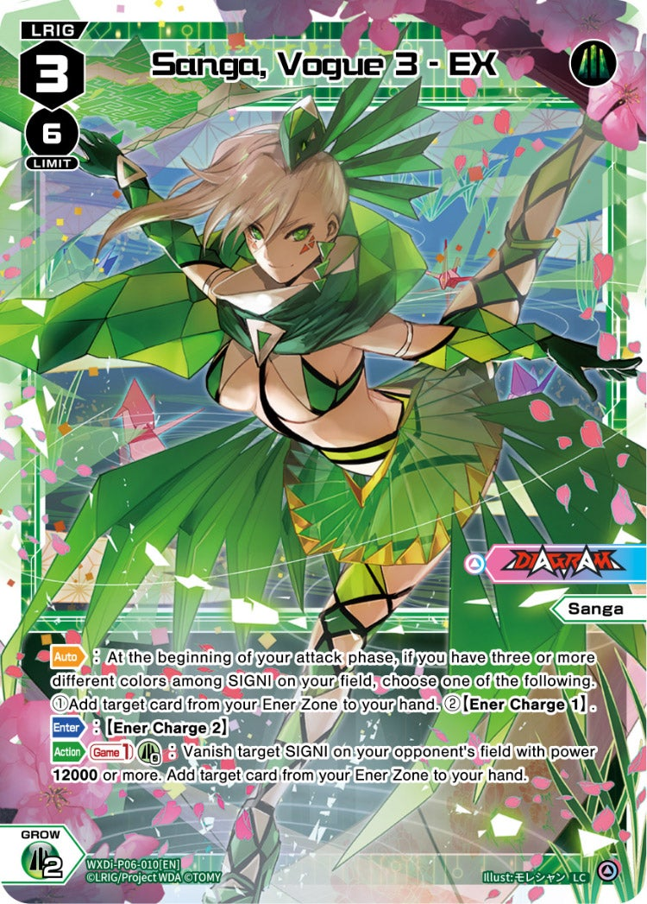

# Sanga, Vogue 3 - EX

## Thông tin lá

| Trường | Giá trị |
| --- | --- |
| Mã in | WXDi-P06-010[EN] |
| Set | WXDi-P06[EN] |
| Số thứ tự | 010 |
| Loại thẻ | LRIG |
| Vị trí | LRIG Deck |
| Số bản | — (set booster, không áp dụng) |
| Màu | Xanh lá |
| Độ hiếm | LC,LR,LRP,UR |
| Minh họa | モレシャン |
| Level | 3 |
| Limit | 6 |
| Power | 0 |
| LRIG type / Class | Sanga |
| Team / Master | DIAGRAM |
| Cost | — |
| Grow cost | 《G》×２ |
| Use timing | — |
| Life Burst | Không |

## Card text chính thức

[Auto]: At the beginning of your attack phase, if you have three or more different colors among SIGNI on your field, choose one of the following. ①Add target card from your Ener Zone to your hand. ②【Ener Charge 1】.
[Enter]: 【Ener Charge 2】
[Action] {1/Game} {Greenx0}: Vanish target SIGNI on your opponent's field with power 12000 or more. Add target card from your Ener Zone to your hand.

## Power text / Life Burst

—

## Ghi chú minh họa
Artist: モレシャン. Ảnh LC được tải từ Card List tiếng Anh.

## FAQ chính thức

**Q. May a colorless SIGNI like 《Servant ♯》 be included in the color type in this [Auto] ability?**
A. No, colorless SIGNI does not have color, so it is not counted as a color type.

**Q. Is it must to add a card from the Ener zone to your hand with the [Action] ability?**
A. Yes, is it. However, if there are no cards in your Ener zone, you can only vanish your opponent's SIGNI.

## Ảnh biến thể

- [LRP](../images/WXDi-P06-010P-EN.jpg)
- [LR](../images/WXDi-P06-010R-EN.jpg)
- [UR](../images/WXDi-P06-010U-EN.jpg)

## Nguồn
[Card List/FAQ chính thức](https://www.takaratomy.co.jp/products/en.wixoss/card/card.html?card_no=WXDi-P06-010%5BEN%5D ) · [Ảnh thẻ](https://www.takaratomy.co.jp/products/en.wixoss/card/thumb/WXDi-P06-010%5BEN%5D.jpg)
