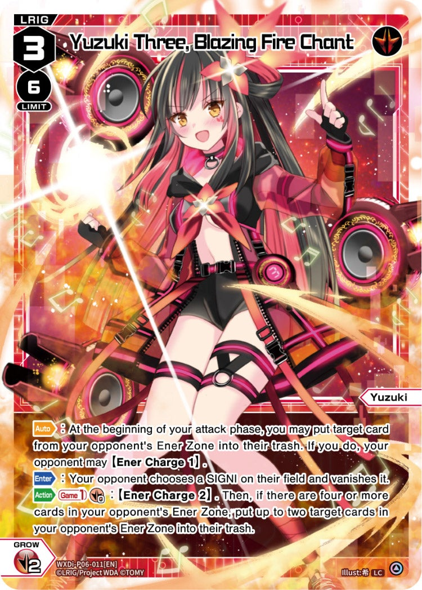

# Yuzuki Three, Blazing Fire Chant

## Thông tin lá

| Trường | Giá trị |
| --- | --- |
| Mã in | WXDi-P06-011[EN] |
| Set | WXDi-P06[EN] |
| Số thứ tự | 011 |
| Loại thẻ | LRIG |
| Vị trí | LRIG Deck |
| Số bản | — (set booster, không áp dụng) |
| Màu | Đỏ |
| Độ hiếm | LC,LR,LRP,UR |
| Minh họa | 希 |
| Level | 3 |
| Limit | 6 |
| Power | 0 |
| LRIG type / Class | Yuzuki |
| Team / Master | — |
| Cost | — |
| Grow cost | 《R》×２ |
| Use timing | — |
| Life Burst | Không |

## Card text chính thức

[Auto]: At the beginning of your attack phase, you may put target card from your opponent's Ener Zone into their trash. If you do, your opponent may 【Ener Charge 1】.
[Enter]: Your opponent chooses a SIGNI on their field and vanishes it.
[Action] {1/Game} {Redx0}: 【Ener Charge 2】. Then, if there are four or more cards in your opponent's Ener Zone, put up to two target cards in your opponent's Ener Zone into their trash.

## Power text / Life Burst

—

## Ghi chú minh họa
Artist: 希. Ảnh LC được tải từ Card List tiếng Anh.

## FAQ chính thức

**Q. Which player decides whether to 【Ener Charge 1】 after put a card into its owner's trash from your opponent's Ener zone with the [Auto] ability?**
A. Your opponent decide it.

**Q. When this LRIG's [Enter] ability is triggered, may my opponent choose a SIGNI with "cannot be vanished"?**
A. Yes, your opponent can do it. In that case, the SIGNI remains on the field without being vanished. As a result, the SIGNI can prevent this effect.

## Ảnh biến thể

- [LRP](../images/WXDi-P06-011P-EN.jpg)
- [LR](../images/WXDi-P06-011R-EN.jpg)
- [UR](../images/WXDi-P06-011U-EN.jpg)

## Nguồn
[Card List/FAQ chính thức](https://www.takaratomy.co.jp/products/en.wixoss/card/card.html?card_no=WXDi-P06-011%5BEN%5D ) · [Ảnh thẻ](https://www.takaratomy.co.jp/products/en.wixoss/card/thumb/WXDi-P06-011%5BEN%5D.jpg)
