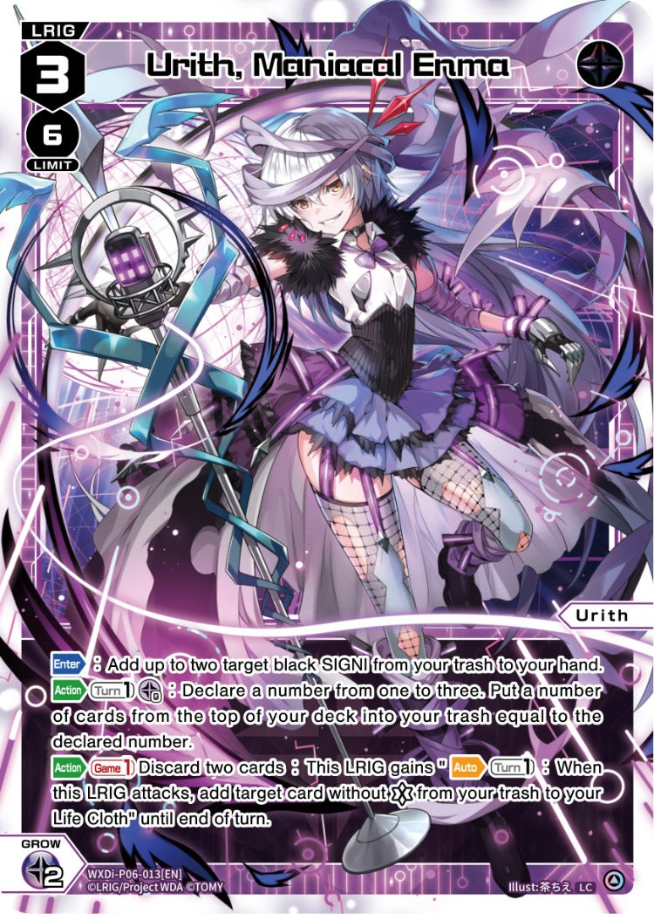

# Urith, Maniacal Enma

## Thông tin lá

| Trường | Giá trị |
| --- | --- |
| Mã in | WXDi-P06-013[EN] |
| Set | WXDi-P06[EN] |
| Số thứ tự | 013 |
| Loại thẻ | LRIG |
| Vị trí | LRIG Deck |
| Số bản | — (set booster, không áp dụng) |
| Màu | Đen |
| Độ hiếm | LC,LR,LRP,UR |
| Minh họa | 茶ちえ |
| Level | 3 |
| Limit | 6 |
| Power | 0 |
| LRIG type / Class | Urith |
| Team / Master | — |
| Cost | — |
| Grow cost | 《B》×２ |
| Use timing | — |
| Life Burst | Không |

## Card text chính thức

[Enter]: Add up to two target black SIGNI from your trash to your hand.
[Action] {1/Turn} {Blackx0}: Declare a number from one to three. Put a number of cards from the top of your deck into your trash equal to the declared number.
[Action] {1/Game} Discard two cards: This LRIG gains "[Auto] {1/Turn}: When this LRIG attacks, add target card without [Life Burst] from your trash to your Life Cloth" until end of turn.

## Power text / Life Burst

—

## Ghi chú minh họa
Artist: 茶ちえ. Ảnh LC được tải từ Card List tiếng Anh.

## FAQ chính thức

**Q. May the second [Action] ability be used when there is one or less cards in my hand?**
A. No. You need two cards in your hand to activate the use of its ability.

## Ảnh biến thể

- [LRP](../images/WXDi-P06-013P-EN.jpg)
- [LR](../images/WXDi-P06-013R-EN.jpg)
- [UR](../images/WXDi-P06-013U-EN.jpg)

## Nguồn
[Card List/FAQ chính thức](https://www.takaratomy.co.jp/products/en.wixoss/card/card.html?card_no=WXDi-P06-013%5BEN%5D ) · [Ảnh thẻ](https://www.takaratomy.co.jp/products/en.wixoss/card/thumb/WXDi-P06-013%5BEN%5D.jpg)
