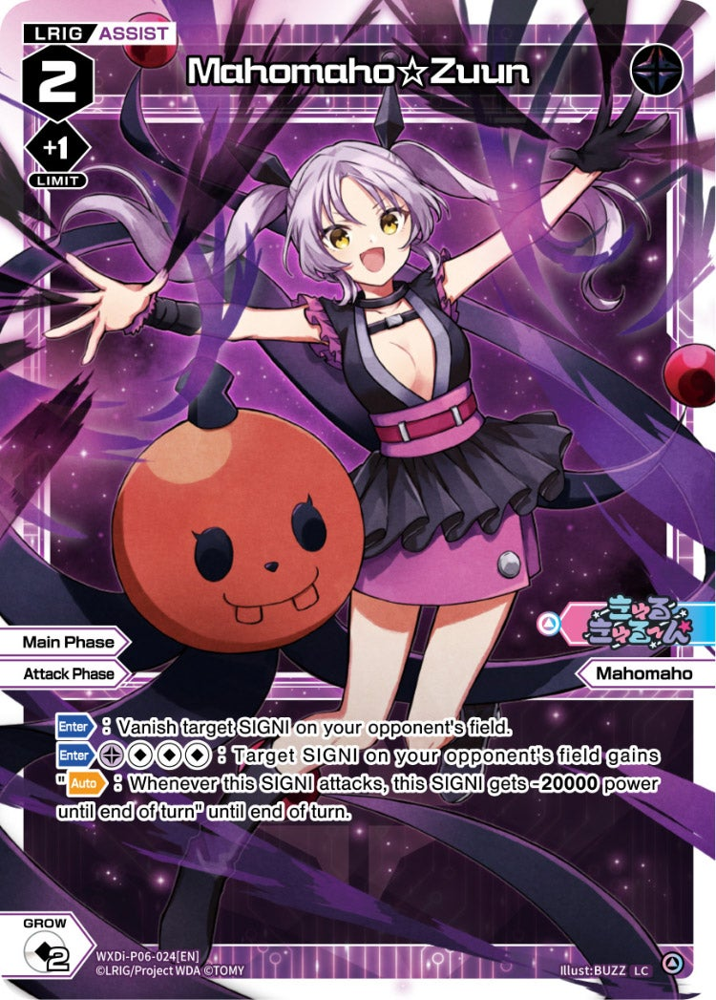

# Mahomaho☆Zuun

## Thông tin lá

| Trường | Giá trị |
| --- | --- |
| Mã in | WXDi-P06-024[EN] |
| Set | WXDi-P06[EN] |
| Số thứ tự | 024 |
| Loại thẻ | ASSIST LRIG |
| Vị trí | LRIG Deck |
| Số bản | — (set booster, không áp dụng) |
| Màu | Đen |
| Độ hiếm | LC,LC(P) |
| Minh họa | BUZZ |
| Level | 2 |
| Limit | ＋１ |
| Power | 0 |
| LRIG type / Class | Mahomaho |
| Team / Master | Kyurukyurun☆ |
| Cost | — |
| Grow cost | 《C》×２ |
| Use timing | Main Phase / Attack Phase |
| Life Burst | Không |

## Card text chính thức

[Enter]: Vanish target SIGNI on your opponent's field.
[Enter] {Black} {Colorless} {Colorless} {Colorless}: Target SIGNI on your opponent's field gains "[Auto]: Whenever this SIGNI attacks, this SIGNI gets -20000 power until end of turn" until end of turn.

## Power text / Life Burst

—

## Ghi chú minh họa
Artist: BUZZ. Ảnh LC được tải từ Card List tiếng Anh.

## FAQ chính thức

**Q. A SIGNI that was made to gain the [Auto] ability with the second [Enter] ability has attacked. What happens to the attack if it get -20000 power and its power become to 0 or less?**
A. SIGNI whose power is became to 0 or less will be vanished according to the rules, so no damage will be dealt by attack. If the SIGNI has another [Auto] ability "When this SIGNI attacks", the SIGNI's ability on the turn player side triggers first because they are both [Auto] abilities, and the SIGNI that attacks after that gets -20000 power.

## Ảnh biến thể

- [LC(P)](../images/WXDi-P06-024P-EN.jpg)

## Nguồn
[Card List/FAQ chính thức](https://www.takaratomy.co.jp/products/en.wixoss/card/card.html?card_no=WXDi-P06-024%5BEN%5D ) · [Ảnh thẻ](https://www.takaratomy.co.jp/products/en.wixoss/card/thumb/WXDi-P06-024%5BEN%5D.jpg)
