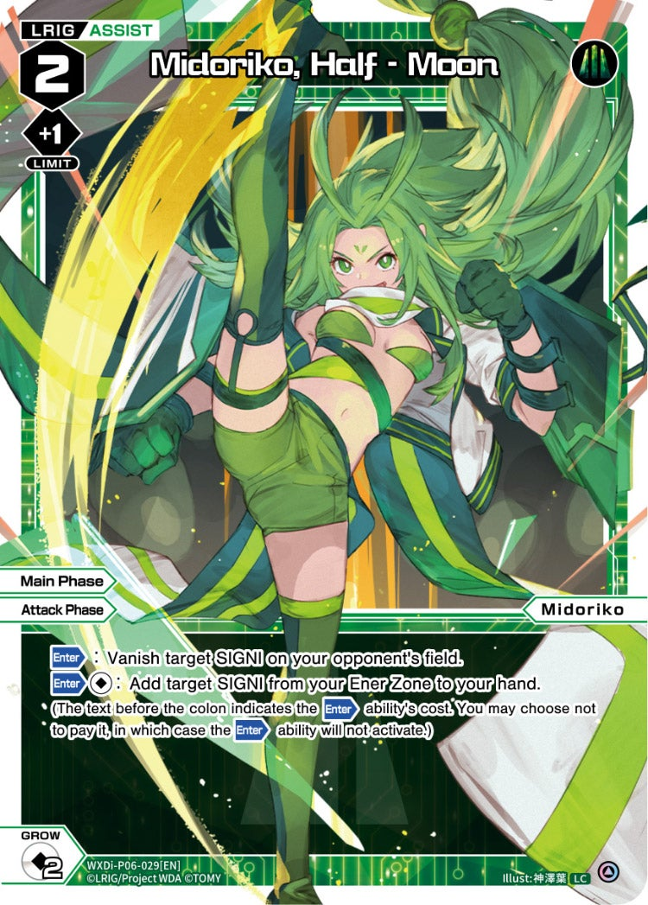

# Midoriko, Half - Moon

## Thông tin lá

| Trường | Giá trị |
| --- | --- |
| Mã in | WXDi-P06-029[EN] |
| Set | WXDi-P06[EN] |
| Số thứ tự | 029 |
| Loại thẻ | ASSIST LRIG |
| Vị trí | LRIG Deck |
| Số bản | — (set booster, không áp dụng) |
| Màu | Xanh lá |
| Độ hiếm | LC,LC(P) |
| Minh họa | 神澤葉 |
| Level | 2 |
| Limit | ＋１ |
| Power | 0 |
| LRIG type / Class | Midoriko |
| Team / Master | — |
| Cost | — |
| Grow cost | 《C》×２ |
| Use timing | Main Phase
Attack Phase |
| Life Burst | Không |

## Card text chính thức

[Enter]: Vanish target SIGNI on your opponent's field.
[Enter] {Colorless}: Add target SIGNI from your Ener Zone to your hand.
(The text before the colon indicates the [Enter] ability's cost. You may choose not to pay it, in which case the [Enter] ability will not activate.)

## Power text / Life Burst

—

## Ghi chú minh họa
Artist: 神澤葉. Ảnh LC được tải từ Card List tiếng Anh.

## FAQ chính thức

**Q. May the second [Enter] ability add a card that paid the {Colourless} cost to my hand under the effect of this ability?**
A. No, you cannot. That effect is targeted at a card in the Ener zone after {Colorless} cost is paid, so the card that was paid for is in your trash at that point.

## Ảnh biến thể

- [LC(P)](../images/WXDi-P06-029P-EN.jpg)

## Nguồn
[Card List/FAQ chính thức](https://www.takaratomy.co.jp/products/en.wixoss/card/card.html?card_no=WXDi-P06-029%5BEN%5D ) · [Ảnh thẻ](https://www.takaratomy.co.jp/products/en.wixoss/card/thumb/WXDi-P06-029%5BEN%5D.jpg)
