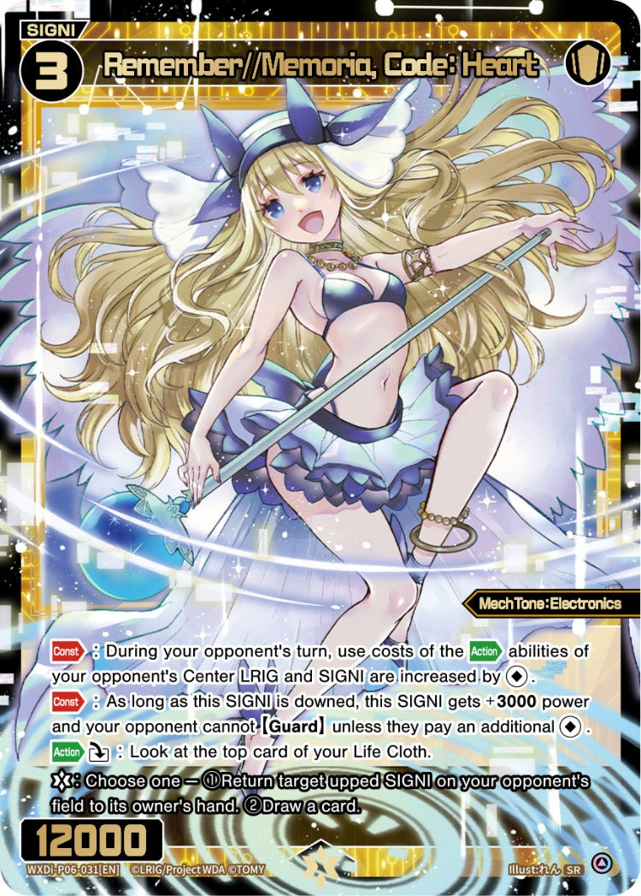

# Remember//Memoria, Code: Heart

## Thông tin lá

| Trường | Giá trị |
| --- | --- |
| Mã in | WXDi-P06-031[EN] |
| Set | WXDi-P06[EN] |
| Số thứ tự | 031 |
| Loại thẻ | SIGNI |
| Vị trí | Main Deck |
| Số bản | — (set booster, không áp dụng) |
| Màu | Trắng |
| Độ hiếm | SR,SRP |
| Minh họa | れん
はしもとなおや |
| Level | 3 |
| Limit | — |
| Power | 12000 |
| LRIG type / Class | Mech Tone：Electronics |
| Team / Master | — |
| Cost | — |
| Grow cost | — |
| Use timing | — |
| Life Burst | Có |

## Card text chính thức

[Constant]: During your opponent's turn, use costs of the [Action] abilities of your opponent's Center LRIG and SIGNI are increased by {Colorless}.
[Constant]: As long as this SIGNI is downed, this SIGNI gets +3000 power and your opponent cannot 【Guard】 unless they pay an additional {Colorless}.
[Action] {Down}: Look at the top card of your Life Cloth.

## Power text / Life Burst

Choose one — ①Return target upped SIGNI on your opponent's field to its owner's hand. ②Draw a card.

## Ghi chú minh họa
Artist: れん
はしもとなおや. Ảnh SR được tải từ Card List tiếng Anh.

## FAQ chính thức

**Q. If there are two of this SIGNI on the field, does the [Constant] ability increase the cost paid by two?**
A. Yes, each one is duplicated, so it will increase. If there are two of them, the cost of  {Colorless} {Colorless} paid by the first [Constant] ability will increase, and if they are in a downed, your opponent will have to pay an additional {Colorless} {Colorless} when your opponent use 【Guard】 .

**Q. May I use the [Action] ability if I have zero Life Cloths?**
A. Yes, you can. This SIGNI goes down, but nothing happens to the effect.

**Q. If this SIGNI attacks, how much power does it have when battling the SIGNI in front of it?**
A. Battles as power 15000. It is +3000 power by the [Constant] ability, which constantly checks whether this SIGNI is down or not, and is immediately added when it is down.

**Q. If this SIGNI attacks, does the 'When a SIGNI on your field with power 15000 or more attacks" ability of 《Fennec, Phantom Terra Beast》 trigger?**
A. No, it does not trigger. The "When a SIGNI on your field with power 15000 or more attacks" is triggered when a SIGNI with power 15000 or more is changed from up to down by an attack declaration. 《Remember//Memoria, Code: Heart》 gets +3000 power after going down, and is power 12000 when it is upped, so it does not trigger the ability of 《Fennec, Phantom Terra Beast》.

**Q. During my opponent's turn, does the cost of using the [Action] ability of 《Steampunk, Code: Ancients》 in my opponent's trash increase?**
A. Yes, it increases. 《Remember///Memoria, Code: Heart》 increases the [Action] abilities cost of "cards that are SIGNI" even if they are not on the field, so if you use the [Action] ability of 《Steampunk, Code: Ancients》 in your opponent's trash, you need to pay {Colorless} cost.

## Ảnh biến thể

- [SRP](../images/WXDi-P06-031P-EN.jpg)

## Nguồn
[Card List/FAQ chính thức](https://www.takaratomy.co.jp/products/en.wixoss/card/card.html?card_no=WXDi-P06-031%5BEN%5D ) · [Ảnh thẻ](https://www.takaratomy.co.jp/products/en.wixoss/card/thumb/WXDi-P06-031%5BEN%5D.jpg)
