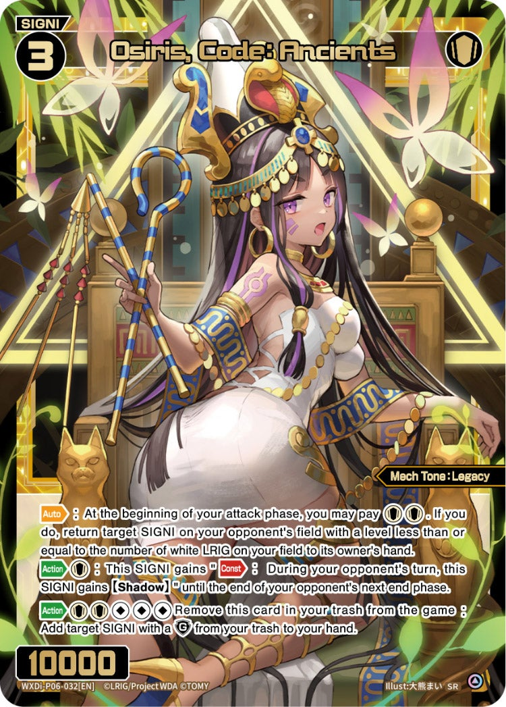

# Osiris, Code: Ancients

## Thông tin lá

| Trường | Giá trị |
| --- | --- |
| Mã in | WXDi-P06-032[EN] |
| Set | WXDi-P06[EN] |
| Số thứ tự | 032 |
| Loại thẻ | SIGNI |
| Vị trí | Main Deck |
| Số bản | — (set booster, không áp dụng) |
| Màu | Trắng |
| Độ hiếm | SR,SRP |
| Minh họa | 大熊まい |
| Level | 3 |
| Limit | — |
| Power | 10000 |
| LRIG type / Class | Mech Tone：Legacy |
| Team / Master | — |
| Cost | — |
| Grow cost | — |
| Use timing | — |
| Life Burst | Không |

## Card text chính thức

[Auto]: At the beginning of your attack phase, you may pay {White} {White}. If you do, return target SIGNI on your opponent's field with a level less than or equal to the number of white LRIG on your field to its owner's hand.
[Action] {White}: This SIGNI gains "[Constant]: During your opponent's turn, this SIGNI gains 【Shadow】" until the end of your opponent's next end phase.

[Action] {White} {White} {Colorless} {Colorless} {Colorless} Remove this card in your trash from the game: Add target SIGNI with a {Guard Icon} from your trash to your hand.

## Power text / Life Burst

—

## Ghi chú minh họa
Artist: 大熊まい. Ảnh SR được tải từ Card List tiếng Anh.

## FAQ chính thức

**Q. When counting the number of white LRIG on my field, may cards under the LRIG also be counted?**
A. No, they don't count. Only the top card is counted as a LRIG. The maximum number of LRIGs counted by this effect is three, if the two assist LRIGs and the center LRIG are all white.

**Q. May I use the second [Action] ability when this card is in my Ener zone, put this SIGNI from my Ener zone to my trash at a cost of {White}, and then remove this card put into my trash as a cost from the game?**
A. No, you cannot. The second [Action] ability can only be used when this SIGNI is in your trash. If it is placed in your Ener zone, you cannot also declare its use.

**Q. May a card paid as an Ener cost for the second [Action] ability be added directly to my hand with this effect when this card is in my trash?**
A. Yes, you can. After paying the Ener cost of the [Action] ability, target a SIGNI that matches the conditions of your trash.

## Ảnh biến thể

- [SRP](../images/WXDi-P06-032P-EN.jpg)

## Nguồn
[Card List/FAQ chính thức](https://www.takaratomy.co.jp/products/en.wixoss/card/card.html?card_no=WXDi-P06-032%5BEN%5D ) · [Ảnh thẻ](https://www.takaratomy.co.jp/products/en.wixoss/card/thumb/WXDi-P06-032%5BEN%5D.jpg)
