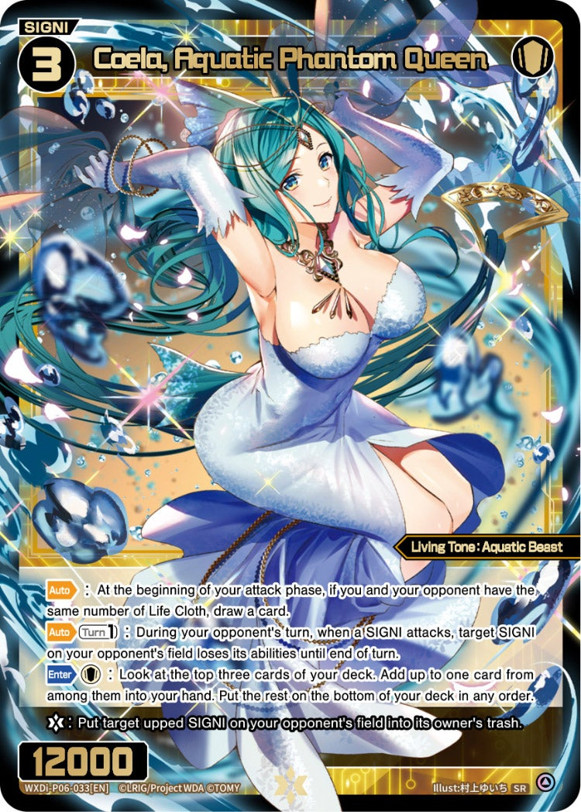

# Coela, Aquatic Phantom Queen

## Thông tin lá

| Trường | Giá trị |
| --- | --- |
| Mã in | WXDi-P06-033[EN] |
| Set | WXDi-P06[EN] |
| Số thứ tự | 033 |
| Loại thẻ | SIGNI |
| Vị trí | Main Deck |
| Số bản | — (set booster, không áp dụng) |
| Màu | Trắng |
| Độ hiếm | SR,SRP |
| Minh họa | 村上ゆいち |
| Level | 3 |
| Limit | — |
| Power | 12000 |
| LRIG type / Class | Living Tone：Aquatic Beast |
| Team / Master | — |
| Cost | — |
| Grow cost | — |
| Use timing | — |
| Life Burst | Có |

## Card text chính thức

[Auto]: At the beginning of your attack phase, if you and your opponent have the same number of Life Cloth, draw a card.
[Auto] {1/Turn}: During your opponent's turn, when a SIGNI attacks, target SIGNI on your opponent's field loses its abilities until end of turn.
[Enter] {White}: Look at the top three cards of your deck. Add up to one card from among them into your hand. Put the rest on the bottom of your deck in any order.

## Power text / Life Burst

Put target upped SIGNI on your opponent's field into its owner's trash.

## Ghi chú minh họa
Artist: 村上ゆいち. Ảnh SR được tải từ Card List tiếng Anh.

## FAQ chính thức

**Q. If both players have zero Life Cloths, may I draw a card by the first [Auto] ability?**
A. Yes, you can draw a card as Life Cloths will be the same number of cards.

**Q. May I target my opponent's SIGNI to lose abilities other than the attacking SIGNI by the second [Auto] ability?**
A. Yes, you can. The target SIGNI does not have to be the attacking SIGNI.

## Ảnh biến thể

- [SRP](../images/WXDi-P06-033P-EN.jpg)

## Nguồn
[Card List/FAQ chính thức](https://www.takaratomy.co.jp/products/en.wixoss/card/card.html?card_no=WXDi-P06-033%5BEN%5D ) · [Ảnh thẻ](https://www.takaratomy.co.jp/products/en.wixoss/card/thumb/WXDi-P06-033%5BEN%5D.jpg)
