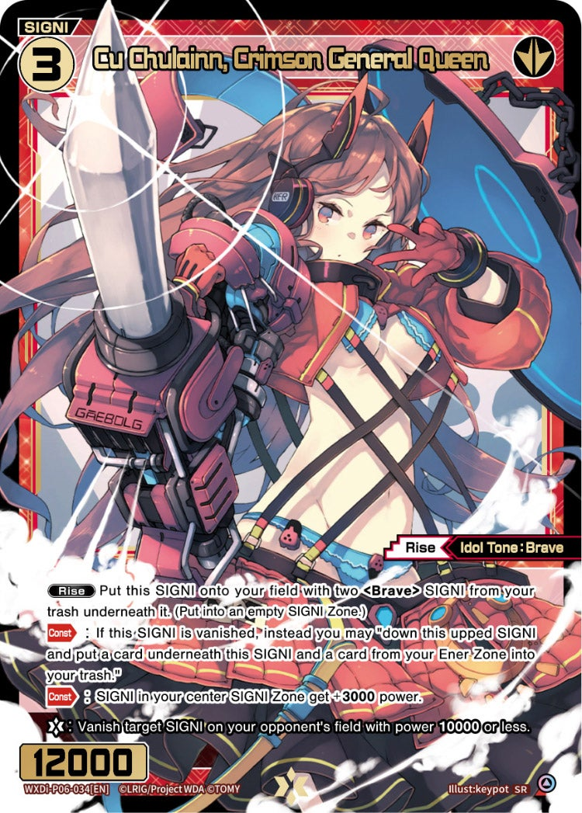

# Cu Chulainn, Crimson General Queen

## Thông tin lá

| Trường | Giá trị |
| --- | --- |
| Mã in | WXDi-P06-034[EN] |
| Set | WXDi-P06[EN] |
| Số thứ tự | 034 |
| Loại thẻ | SIGNI |
| Vị trí | Main Deck |
| Số bản | — (set booster, không áp dụng) |
| Màu | Đỏ |
| Độ hiếm | SR,SRP |
| Minh họa | keypot |
| Level | 3 |
| Limit | — |
| Power | 12000 |
| LRIG type / Class | Idol Tone：Brave |
| Team / Master | — |
| Cost | — |
| Grow cost | — |
| Use timing | — |
| Life Burst | Có |

## Card text chính thức

[Rise] Put this SIGNI onto your field with two <Brave> SIGNI from your trash underneath it. (Put into an empty SIGNI Zone.)
[Constant]: If this SIGNI is vanished, instead you may "down this upped SIGNI and put a card underneath this SIGNI and a card from your Ener Zone into your trash."
[Constant]: SIGNI in your center SIGNI Zone get +3000 power.

## Power text / Life Burst

Vanish target SIGNI on your opponent's field with power 10000 or less.

## Ghi chú minh họa
Artist: keypot. Ảnh SR được tải từ Card List tiếng Anh.

## FAQ chính thức

**Q. If there are no two <Brave> SIGNI in my trash, can this SIGNI not be put on the field?**
A. Yes, a SIGNI with [Rise] cannot be put on the field if the conditions cannot be met.

**Q. If the first [Constant] ability replaces this SIGNI's vanish, may it be replaced even if there are no cards under this SIGNI or in my Ener zone?**
A. No, you cannot replace a vanish without doing all the conditions, and you cannot perform only some of them.

**Q. My opponent's SIGNI with 【Lancer】 attacked and battled 《Cu Chulainn, Crimson General Queen》. If 《Cu Chulainn, Crimson General Queen》 stays on the field due to the [Constant] ability instead of being vanished, does the 【Lancer】 effect cause a life crush?**
A. No, 【Lancer】 does not trigger. 【Lancer】 is an ability that is triggered when a SIGNI is actually vanished, so it will not trigger if the vanishing is replaced by the [Constant] ability of 《Cu Chulainn, Crimson General Queen》, for example.

**Q. My opponent's effect reduced the power of 《Cu Chulainn, Crimson General Queen》, reducing its power to 0 or less. May the [Constant] ability of 《Cu Chulainn, Crimson General Queen》 replace the vanish caused by the power being reduced to 0 or less and stay on the field?**
A. Vanishing by Rule-based action can also be replaced once by the [Constant] ability of 《Cu Chulainn, Crimson General Queen》, but 《Cu Chulainn, Crimson General Queen》 will still have a power of 0. So immediately after it is replaced and stays on the field, it is checked again by Rule-based action, and is consequently vanished.

## Ảnh biến thể

- [SRP](../images/WXDi-P06-034P-EN.jpg)

## Nguồn
[Card List/FAQ chính thức](https://www.takaratomy.co.jp/products/en.wixoss/card/card.html?card_no=WXDi-P06-034%5BEN%5D ) · [Ảnh thẻ](https://www.takaratomy.co.jp/products/en.wixoss/card/thumb/WXDi-P06-034%5BEN%5D.jpg)
