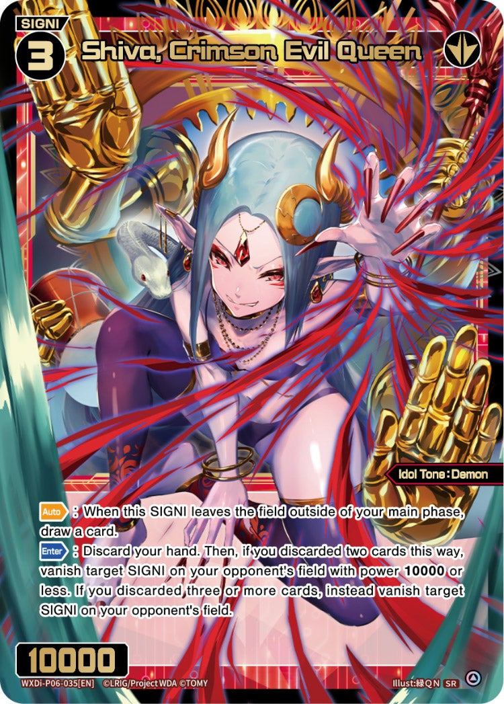

# Shiva, Crimson Evil Queen

## Thông tin lá

| Trường | Giá trị |
| --- | --- |
| Mã in | WXDi-P06-035[EN] |
| Set | WXDi-P06[EN] |
| Số thứ tự | 035 |
| Loại thẻ | SIGNI |
| Vị trí | Main Deck |
| Số bản | — (set booster, không áp dụng) |
| Màu | Đỏ |
| Độ hiếm | SR,SRP |
| Minh họa | 緑ＱＮ |
| Level | 3 |
| Limit | — |
| Power | 10000 |
| LRIG type / Class | Idol Tone：Demon |
| Team / Master | — |
| Cost | — |
| Grow cost | — |
| Use timing | — |
| Life Burst | Không |

## Card text chính thức

[Auto]: When this SIGNI leaves the field outside of your main phase, draw a card.
[Enter]: Discard your hand. Then, if you discarded two cards this way, vanish target SIGNI on your opponent's field with power 10000 or less. If you discarded three or more cards, instead vanish target SIGNI on your opponent's field.

## Power text / Life Burst

—

## Ghi chú minh họa
Artist: 緑ＱＮ. Ảnh SR được tải từ Card List tiếng Anh.

## FAQ chính thức

**Q. If I put this SIGNI from the field to my Ener zone as an Ener Charge in the Ener Phase, does the [Auto] ability trigger?**
A. Yes, it is triggered.

**Q. Does the [Enter] ability must trigger?**
A. Yes, the [Enter] ability without cost is must triggered. You must discard a card even if you have only one card in your hand and do not want to discard it.

## Ảnh biến thể

- [SRP](../images/WXDi-P06-035P-EN.jpg)

## Nguồn
[Card List/FAQ chính thức](https://www.takaratomy.co.jp/products/en.wixoss/card/card.html?card_no=WXDi-P06-035%5BEN%5D ) · [Ảnh thẻ](https://www.takaratomy.co.jp/products/en.wixoss/card/thumb/WXDi-P06-035%5BEN%5D.jpg)
