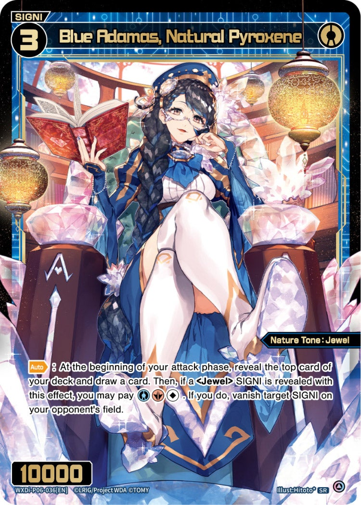

# Blue Adamas, Natural Pyroxene

## Thông tin lá

| Trường | Giá trị |
| --- | --- |
| Mã in | WXDi-P06-036[EN] |
| Set | WXDi-P06[EN] |
| Số thứ tự | 036 |
| Loại thẻ | SIGNI |
| Vị trí | Main Deck |
| Số bản | — (set booster, không áp dụng) |
| Màu | Xanh dương |
| Độ hiếm | SR,SRP |
| Minh họa | Hitoto* |
| Level | 3 |
| Limit | — |
| Power | 10000 |
| LRIG type / Class | Nature Tone：Jewel |
| Team / Master | — |
| Cost | — |
| Grow cost | — |
| Use timing | — |
| Life Burst | Không |

## Card text chính thức

[Auto]: At the beginning of your attack phase, reveal the top card of your deck and draw a card. Then, if a <Jewel> SIGNI is revealed with this effect, you may pay {Blue} {Red} {Colorless}. If you do, vanish target SIGNI on your opponent's field.

## Power text / Life Burst

—

## Ghi chú minh họa
Artist: Hitoto*. Ảnh SR được tải từ Card List tiếng Anh.

## FAQ chính thức

**Q. Is it the revealed card that draws the card by the [Auto] ability?**
A. Yes, draw the revealed card as it is and add it to your hand.

**Q. When does this ability target a SIGNI?**
A. You can target after paying {Blue} {Red} {Cololess}. If you do not pay, you do not choose a target.

## Ảnh biến thể

- [SRP](../images/WXDi-P06-036P-EN.jpg)

## Nguồn
[Card List/FAQ chính thức](https://www.takaratomy.co.jp/products/en.wixoss/card/card.html?card_no=WXDi-P06-036%5BEN%5D ) · [Ảnh thẻ](https://www.takaratomy.co.jp/products/en.wixoss/card/thumb/WXDi-P06-036%5BEN%5D.jpg)
