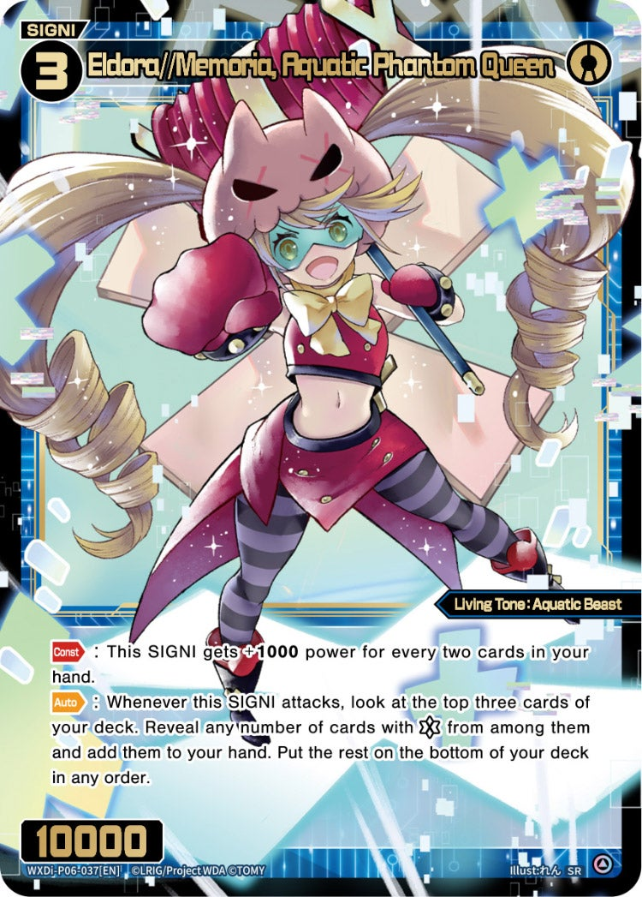

# Eldora//Memoria, Aquatic Phantom Queen

## Thông tin lá

| Trường | Giá trị |
| --- | --- |
| Mã in | WXDi-P06-037[EN] |
| Set | WXDi-P06[EN] |
| Số thứ tự | 037 |
| Loại thẻ | SIGNI |
| Vị trí | Main Deck |
| Số bản | — (set booster, không áp dụng) |
| Màu | Xanh dương |
| Độ hiếm | SR,SRP |
| Minh họa | れん
イチゼン |
| Level | 3 |
| Limit | — |
| Power | 10000 |
| LRIG type / Class | Living Tone：Aquatic Beast |
| Team / Master | — |
| Cost | — |
| Grow cost | — |
| Use timing | — |
| Life Burst | Không |

## Card text chính thức

[Constant]: This SIGNI gets +1000 power for every two cards in your hand.
[Auto]: Whenever this SIGNI attacks, look at the top three cards of your deck. Reveal any number of cards with [Life Burst] from among them and add them to your hand. Put the rest on the bottom of your deck in any order.

## Power text / Life Burst

—

## Ghi chú minh họa
Artist: れん
イチゼン. Ảnh SR được tải từ Card List tiếng Anh.

## FAQ chính thức

**Q. If there are five cards in my hand, how many power does this SIGNI get?**
A. This card gets +1000 power per two cards in your hand, so it gets +2000 power.

## Ảnh biến thể

- [SRP](../images/WXDi-P06-037P-EN.jpg)

## Nguồn
[Card List/FAQ chính thức](https://www.takaratomy.co.jp/products/en.wixoss/card/card.html?card_no=WXDi-P06-037%5BEN%5D ) · [Ảnh thẻ](https://www.takaratomy.co.jp/products/en.wixoss/card/thumb/WXDi-P06-037%5BEN%5D.jpg)
