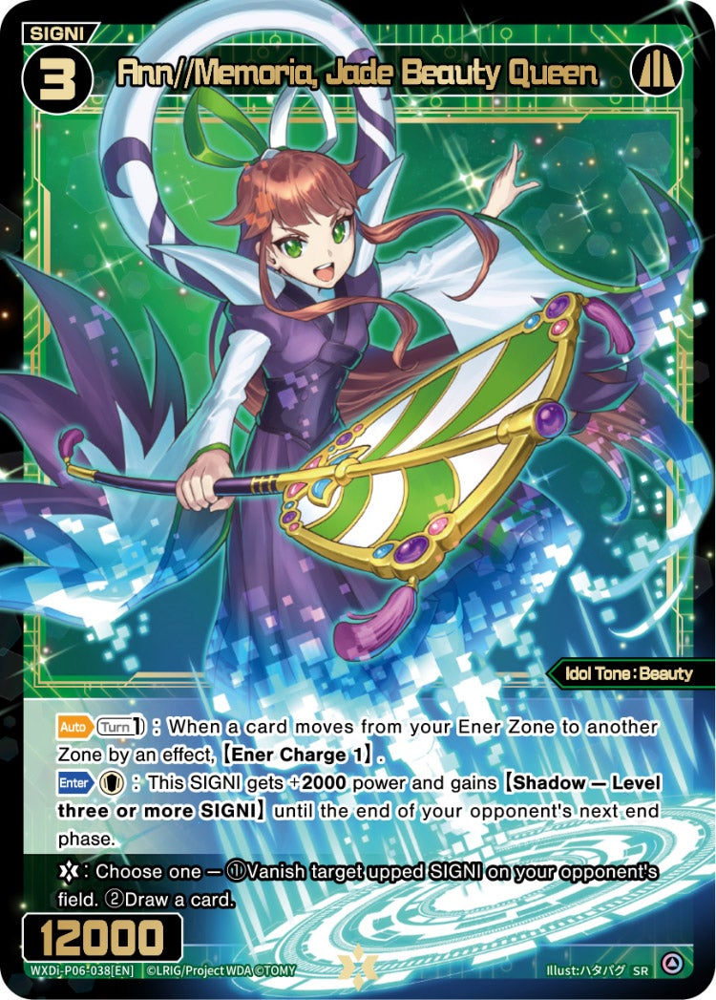

# Ann//Memoria, Jade Beauty Queen

## Thông tin lá

| Trường | Giá trị |
| --- | --- |
| Mã in | WXDi-P06-038[EN] |
| Set | WXDi-P06[EN] |
| Số thứ tự | 038 |
| Loại thẻ | SIGNI |
| Vị trí | Main Deck |
| Số bản | — (set booster, không áp dụng) |
| Màu | Xanh lá |
| Độ hiếm | SR,SRP |
| Minh họa | ハタパグ
北熊 |
| Level | 3 |
| Limit | — |
| Power | 12000 |
| LRIG type / Class | Idol Tone：Beauty |
| Team / Master | — |
| Cost | — |
| Grow cost | — |
| Use timing | — |
| Life Burst | Có |

## Card text chính thức

[Auto] {1/Turn}: When a card moves from your Ener Zone to another Zone by an effect, 【Ener Charge 1】.
[Enter] {White}: This SIGNI gets +2000 power and gains 【Shadow — Level three or more SIGNI】 until the end of your opponent's next end phase.

## Power text / Life Burst

Choose one — ①Vanish target upped SIGNI on your opponent's field. ②Draw a card.

## Ghi chú minh họa
Artist: ハタパグ
北熊. Ảnh SR được tải từ Card List tiếng Anh.

## FAQ chính thức

**Q. Does the [Auto] ability trigger if two or more cards are moved at once, such as an effect that add two cards to my hand from my Ener zone?**
A. Yes, it will also trigger in that case. If two cards are moved, the [Auto] ability is triggered twice, but it is a {1/Turn} ability, so it will only trigger once and the rest will be non-triggered.

**Q. If this card gains 【Shadow — Level three or more SIGNI】, does this card targeted by the Life Burst effect of a level 3 or higher SIGNI?**
A. No. If it is a card of a level three or higher SIGNI, even if it is a Life Burst, it is not target to the effect.

**Q. If I put 《Ann//Memoria, Jade Beauty Queen》 in my Ener zone onto the field from my Ener zone by an effect such as 《Sanga//Parallel》, does the [Auto] ability of 《Ann//Memoria, Jade Beauty Queen》 trigger?**
A. Yes, it is triggered.

## Ảnh biến thể

- [SRP](../images/WXDi-P06-038P-EN.jpg)

## Nguồn
[Card List/FAQ chính thức](https://www.takaratomy.co.jp/products/en.wixoss/card/card.html?card_no=WXDi-P06-038%5BEN%5D ) · [Ảnh thẻ](https://www.takaratomy.co.jp/products/en.wixoss/card/thumb/WXDi-P06-038%5BEN%5D.jpg)
