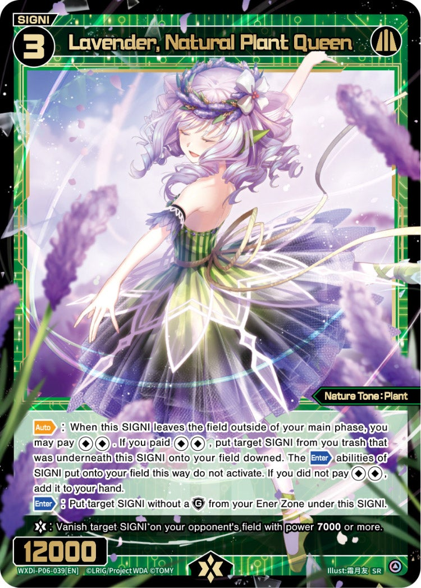

# Lavender, Natural Plant Queen

## Thông tin lá

| Trường | Giá trị |
| --- | --- |
| Mã in | WXDi-P06-039[EN] |
| Set | WXDi-P06[EN] |
| Số thứ tự | 039 |
| Loại thẻ | SIGNI |
| Vị trí | Main Deck |
| Số bản | — (set booster, không áp dụng) |
| Màu | Xanh lá |
| Độ hiếm | SR,SRP |
| Minh họa | 霜月友 |
| Level | 3 |
| Limit | — |
| Power | 12000 |
| LRIG type / Class | Nature Tone：Plant |
| Team / Master | — |
| Cost | — |
| Grow cost | — |
| Use timing | — |
| Life Burst | Có |

## Card text chính thức

[Auto]: When this SIGNI leaves the field outside of your main phase, you may pay {Colorless} {Colorless}. If you paid {Colorless} {Colorless}, put target SIGNI from your trash that was underneath this SIGNI onto your field downed. The [Enter] abilities of SIGNI put onto your field this way do not activate. If you did not pay {Colorless} {Colorless}, add it to your hand.
[Enter]: Put target SIGNI without a {Guard Icon} from your Ener Zone under this SIGNI.

## Power text / Life Burst

Vanish target SIGNI on your opponent's field with power 7000 or more.

## Ghi chú minh họa
Artist: 霜月友. Ảnh SR được tải từ Card List tiếng Anh.

## FAQ chính thức

**Q. When the [Auto] ability puts a SIGNI from my trash onto the field, does it have to be in the SIGNI zone where this SIGNI was originally?**
A. No. You can put it out anywhere you like, as long as it is in an empty SIGNI zone.

## Ảnh biến thể

- [SRP](../images/WXDi-P06-039P-EN.jpg)

## Nguồn
[Card List/FAQ chính thức](https://www.takaratomy.co.jp/products/en.wixoss/card/card.html?card_no=WXDi-P06-039%5BEN%5D ) · [Ảnh thẻ](https://www.takaratomy.co.jp/products/en.wixoss/card/thumb/WXDi-P06-039%5BEN%5D.jpg)
