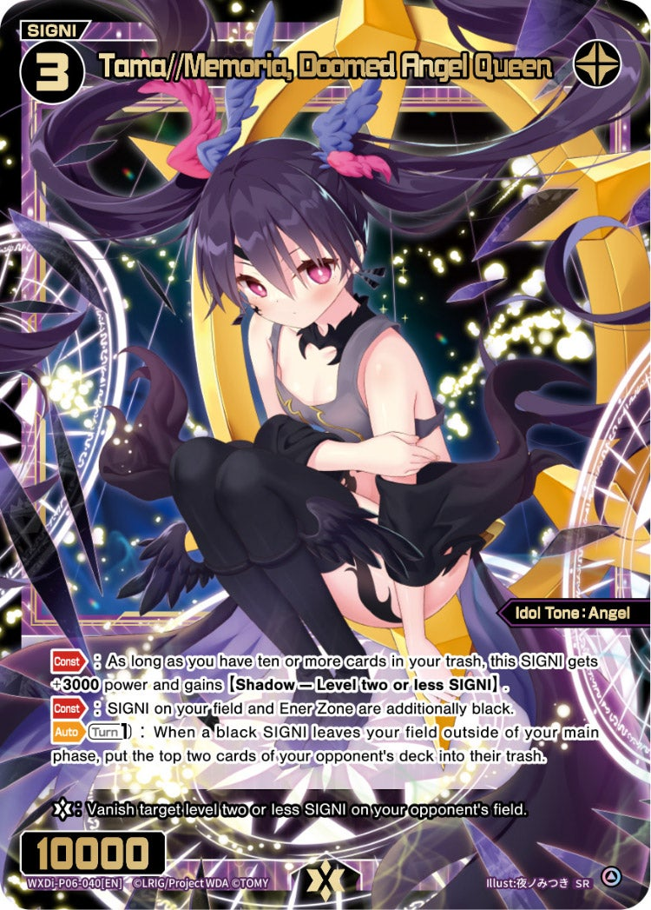

# Tama//Memoria, Doomed Angel Queen

## Thông tin lá

| Trường | Giá trị |
| --- | --- |
| Mã in | WXDi-P06-040[EN] |
| Set | WXDi-P06[EN] |
| Số thứ tự | 040 |
| Loại thẻ | SIGNI |
| Vị trí | Main Deck |
| Số bản | — (set booster, không áp dụng) |
| Màu | Đen |
| Độ hiếm | SR,SRP |
| Minh họa | 夜ノみつき / アカバネ |
| Level | 3 |
| Limit | — |
| Power | 10000 |
| LRIG type / Class | Idol Tone：Angel |
| Team / Master | — |
| Cost | — |
| Grow cost | — |
| Use timing | — |
| Life Burst | Có |

## Card text chính thức

[Constant]: As long as you have ten or more cards in your trash, this SIGNI gets +3000 power and gains 【Shadow — Level two or less SIGNI】.
[Constant]: SIGNI on your field and Ener Zone are additionally black.
[Auto] {1/Turn}: When a black SIGNI leaves your field outside of your main phase, put the top two cards of your opponent's deck into their trash.

## Power text / Life Burst

Vanish target level two or less SIGNI on your opponent's field.

## Ghi chú minh họa
Artist: 夜ノみつき / アカバネ. Ảnh SR được tải từ Card List tiếng Anh.

## FAQ chính thức

**Q. If a SIGNI in my Ener zone gains black, can it be paid as a {black} Ener cost?**
A. Yes, you can.

**Q. Does the [Auto] ability also trigger when this SIGNI itself leaves the field?**
A. Yes, it is triggered.

## Ảnh biến thể

- [SRP](../images/WXDi-P06-040P-EN.jpg)

## Nguồn
[Card List/FAQ chính thức](https://www.takaratomy.co.jp/products/en.wixoss/card/card.html?card_no=WXDi-P06-040%5BEN%5D ) · [Ảnh thẻ](https://www.takaratomy.co.jp/products/en.wixoss/card/thumb/WXDi-P06-040%5BEN%5D.jpg)
