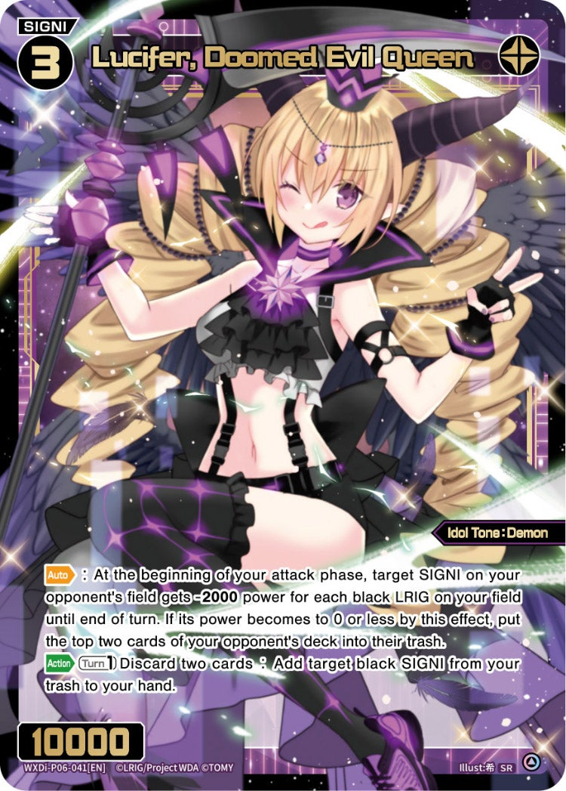

# Lucifer, Doomed Evil Queen

## Thông tin lá

| Trường | Giá trị |
| --- | --- |
| Mã in | WXDi-P06-041[EN] |
| Set | WXDi-P06[EN] |
| Số thứ tự | 041 |
| Loại thẻ | SIGNI |
| Vị trí | Main Deck |
| Số bản | — (set booster, không áp dụng) |
| Màu | Đen |
| Độ hiếm | SR,SRP |
| Minh họa | 希 |
| Level | 3 |
| Limit | — |
| Power | 10000 |
| LRIG type / Class | Idol Tone：Demon |
| Team / Master | — |
| Cost | — |
| Grow cost | — |
| Use timing | — |
| Life Burst | Không |

## Card text chính thức

[Auto]: At the beginning of your attack phase, target SIGNI on your opponent's field gets -2000 power for each black LRIG on your field until end of turn. If its power becomes to 0 or less by this effect, put the top two cards of your opponent's deck into their trash.
[Action] {1/Turn} Discard two cards: Add target black SIGNI from your trash to your hand.

## Power text / Life Burst

—

## Ghi chú minh họa
Artist: 希. Ảnh SR được tải từ Card List tiếng Anh.

## FAQ chính thức

**Q. When counting the number of black LRIG on my field, may cards under the LRIG also be counted?**
A. No, they don't count. Only the top card is counted as a LRIG. The maximum number of LRIGs counted by this effect is three, if the two assist LRIGs and the center LRIG are all black.

**Q. May the [Action] ability be used when there is one or less cards in my hand?**
A. No. You need two cards in your hand to activate the use of its ability.

## Ảnh biến thể

- [SRP](../images/WXDi-P06-041P-EN.jpg)

## Nguồn
[Card List/FAQ chính thức](https://www.takaratomy.co.jp/products/en.wixoss/card/card.html?card_no=WXDi-P06-041%5BEN%5D ) · [Ảnh thẻ](https://www.takaratomy.co.jp/products/en.wixoss/card/thumb/WXDi-P06-041%5BEN%5D.jpg)
