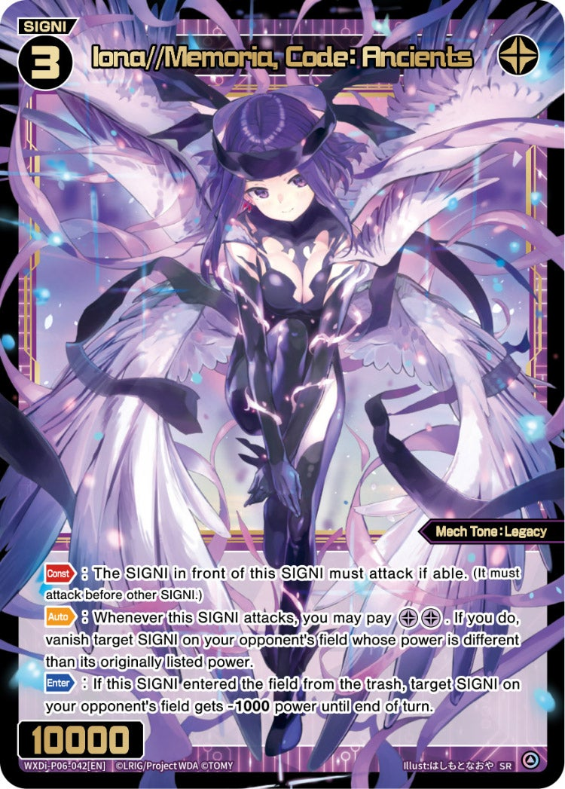

# Iona//Memoria, Code: Ancients

## Thông tin lá

| Trường | Giá trị |
| --- | --- |
| Mã in | WXDi-P06-042[EN] |
| Set | WXDi-P06[EN] |
| Số thứ tự | 042 |
| Loại thẻ | SIGNI |
| Vị trí | Main Deck |
| Số bản | — (set booster, không áp dụng) |
| Màu | Đen |
| Độ hiếm | SR,SRP |
| Minh họa | 神澤葉 / はしもとなおや |
| Level | 3 |
| Limit | — |
| Power | 10000 |
| LRIG type / Class | Mech Tone：Legacy |
| Team / Master | — |
| Cost | — |
| Grow cost | — |
| Use timing | — |
| Life Burst | Không |

## Card text chính thức

[Constant]: The SIGNI in front of this SIGNI must attack if able. (It must attack before other SIGNI.)
[Auto]: Whenever this SIGNI attacks, you may pay {Black} {Black}. If you do, vanish target SIGNI on your opponent's field whose power is different than its originally listed power.
[Enter]: If this SIGNI entered the field from the trash, target SIGNI on your opponent's field gets -1000 power until end of turn.

## Power text / Life Burst

—

## Ghi chú minh họa
Artist: 神澤葉 / はしもとなおや. Ảnh SR được tải từ Card List tiếng Anh.

## FAQ chính thức

**Q. What exactly does "power is different than its originally listed power." mean?**
A. This is a state in which the current power differs from the value listed in the lower left corner of SIGNI due to some process, such as an effect that modifies the power plus or minus, or an effect that sets the base power to a specific value, such as "base power becomes 8000".

**Q. There are two these SIGNI on the field and my opponent has three SIGNI on the field. In which order must your opponent attack?**
A. One of the two SIGNI in front of two 《Iona///Memoria, Code: Ancients》 will attack first. After those two SIGNI have attacked, a third SIGNI that is not in front of 《Iona//Memoria, Code: Ancients》 can attack. (That SIGNI does not have to attack.)

**Q. I made the [Auto] ability of 《Tamamozen, Phantom Spirit Queen》 gain "[Constant]: This SIGNI cannot attack unless you pay {Colourless}" against my opponent's SIGNI in front of this SIGNI. Does that SIGNI must attack by paying Ener?**
A. No, not necessarily. That SIGNI must attack if it can, but it is not forced to pay Ener, so if your opponent chooses not to pay, it is an unattackable SIGNI and consequently your opponent can choose not to attack. In this case, your opponent can also choose to pay Ener to attack that SIGNI after another SIGNI has attacked.

## Ảnh biến thể

- [SRP](../images/WXDi-P06-042P-EN.jpg)

## Nguồn
[Card List/FAQ chính thức](https://www.takaratomy.co.jp/products/en.wixoss/card/card.html?card_no=WXDi-P06-042%5BEN%5D ) · [Ảnh thẻ](https://www.takaratomy.co.jp/products/en.wixoss/card/thumb/WXDi-P06-042%5BEN%5D.jpg)
