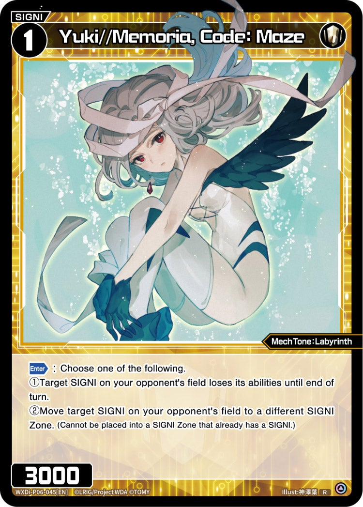

# Yuki//Memoria, Code: Maze

## Thông tin lá

| Trường | Giá trị |
| --- | --- |
| Mã in | WXDi-P06-045[EN] |
| Set | WXDi-P06[EN] |
| Số thứ tự | 045 |
| Loại thẻ | SIGNI |
| Vị trí | Main Deck |
| Số bản | — (set booster, không áp dụng) |
| Màu | Trắng |
| Độ hiếm | R,R(P) |
| Minh họa | 神澤葉 / はしもとなおや |
| Level | 1 |
| Limit | — |
| Power | 3000 |
| LRIG type / Class | Mech Tone：Labyrinth |
| Team / Master | — |
| Cost | — |
| Grow cost | — |
| Use timing | — |
| Life Burst | Không |

## Card text chính thức

[Enter]: Choose one of the following.
①Target SIGNI on your opponent's field loses its abilities until end of turn.
②Move target SIGNI on your opponent's field to a different SIGNI Zone. (Cannot be placed into a SIGNI Zone that already has a SIGNI.)

## Power text / Life Burst

—

## Ghi chú minh họa
Artist: 神澤葉 / はしもとなおや. Ảnh R được tải từ Card List tiếng Anh.

## FAQ chính thức

**Q. May I place my opponent's SIGNI in my SIGNI zone?**
A. No. You can only be placed in your opponent's empty SIGNI zone.

## Ảnh biến thể

- [R(P)](../images/WXDi-P06-045P-EN.jpg)

## Nguồn
[Card List/FAQ chính thức](https://www.takaratomy.co.jp/products/en.wixoss/card/card.html?card_no=WXDi-P06-045%5BEN%5D ) · [Ảnh thẻ](https://www.takaratomy.co.jp/products/en.wixoss/card/thumb/WXDi-P06-045%5BEN%5D.jpg)
