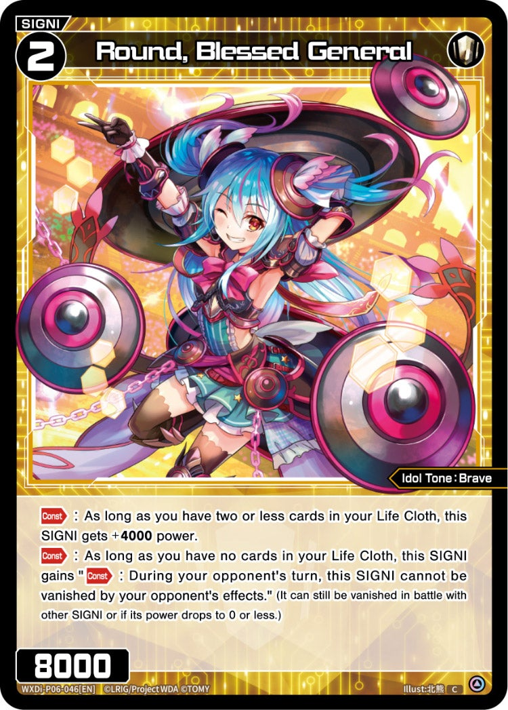

# Round, Blessed General

## Thông tin lá

| Trường | Giá trị |
| --- | --- |
| Mã in | WXDi-P06-046[EN] |
| Set | WXDi-P06[EN] |
| Số thứ tự | 046 |
| Loại thẻ | SIGNI |
| Vị trí | Main Deck |
| Số bản | — (set booster, không áp dụng) |
| Màu | Trắng |
| Độ hiếm | C,C(P) |
| Minh họa | 北熊 |
| Level | 2 |
| Limit | — |
| Power | 8000 |
| LRIG type / Class | Idol Tone：Brave |
| Team / Master | — |
| Cost | — |
| Grow cost | — |
| Use timing | — |
| Life Burst | Không |

## Card text chính thức

[Constant]: As long as you have two or less cards in your Life Cloth, this SIGNI gets +4000 power.
[Constant]: As long as you have no cards in your Life Cloth, this SIGNI gains "[Constant]: During your opponent's turn, this SIGNI cannot be vanished by your opponent's effects." (It can still be vanished in battle with other SIGNI or if its power drops to 0 or less.)

## Power text / Life Burst

—

## Ghi chú minh họa
Artist: 北熊. Ảnh C được tải từ Card List tiếng Anh.

## FAQ chính thức

**Q. If there are zero Life Cloths, are both [Constant] abilities become effective?**
A. Yes, if you have zero Life Cloths, it gets +4000 power for the first [Constant] ability and gains the ability for the second [Constant] ability.

## Ảnh biến thể

- [C(P)](../images/WXDi-P06-046P-EN.jpg)

## Nguồn
[Card List/FAQ chính thức](https://www.takaratomy.co.jp/products/en.wixoss/card/card.html?card_no=WXDi-P06-046%5BEN%5D ) · [Ảnh thẻ](https://www.takaratomy.co.jp/products/en.wixoss/card/thumb/WXDi-P06-046%5BEN%5D.jpg)
